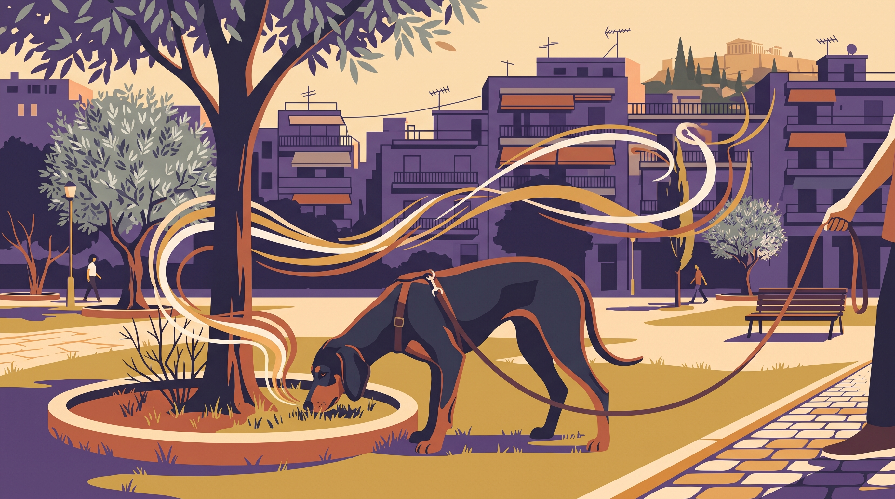

# **03\. Κυνηγόσκυλα στην πόλη (Μπιγκλ, Πόιντερ, Σέττερ, Κόκερ): Όταν η μύτη τους «κλείνει» τα αυτιά τους**

**Κατηγορία:** 02 - Φυλές, Ημίαιμα & Γενετικά Ένστικτα στο Διαμέρισμα  
**Προτεινόμενο URL:** /blog/kynigoskyla-stin-poli-mpigkl-ekpaidefsi  
**Χρόνος ανάγνωσης:** 2 λεπτά

**Με μια ματιά (TL;DR)**

> * Το ενδιαφέρον για μυρωδιές μπορεί να γίνει μέρος της συνεργασίας.
> * Η επαναφορά εξασκείται με ασφάλεια, όχι με δοκιμές κοντά σε δρόμο.
> * Δεν είναι όλα τα κυνηγόσκυλα ίδια ούτε «κουφά από πείσμα».

## **Όταν η μυρωδιά έχει μεγαλύτερη αξία**

Μπιγκλ, Πόιντερ, Σέττερ και Κόκερ προέρχονται από διαφορετικές εργασίες και μπορεί να δείχνουν διαφορετικά ενδιαφέροντα. Η έντονη εξερεύνηση δεν είναι προσωπική απόρριψη του κηδεμόνα.

Αν η μόνη επικοινωνία σας είναι «σταμάτα να μυρίζεις», η βόλτα γίνεται σύγκρουση. Χρειάζεται να συνδυάσετε ασφαλή εξερεύνηση με δεξιότητες που έχουν μάθει πρώτα σε ευκολότερο περιβάλλον.

## **Κάντε τη μύτη σύμμαχο**

1. **Δώστε χρόνο εξερεύνησης:** Επιλέξτε ασφαλή διαδρομή και κατάλληλο μήκος λουριού, μακριά από κυκλοφορία.
2. **Επιβραβεύστε το αυθόρμητο κοίταγμα:** Μια λιχουδιά ή επιστροφή στην ενδιαφέρουσα μυρωδιά μπορεί να ενισχύσει τη σύνδεση.
3. **Διδάξτε επαναφορά σε εύκολο χώρο:** Καλέστε μία φορά όταν είναι πιθανό να ανταποκριθεί. Επιβραβεύστε γενναιόδωρα και συχνά αφήστε τον να εξερευνήσει ξανά.
4. **Χρησιμοποιήστε μακρύ λουρί όπου επιτρέπεται:** Μόνο σε ανοιχτό χώρο χωρίς κινδύνους μπλεξίματος, με σύνδεση σε κατάλληλο σαμαράκι.

## **Τι δεν ζητάμε**

Δεν απαιτούμε επιστροφή από έντονη καταδίωξη ως πρώτη άσκηση και δεν τιμωρούμε την καθυστερημένη άφιξη. Δεν αφήνουμε τον σκύλο λυτό επειδή «πάντα γυρίζει τελικά».

Αν υπάρχει έντονο κυνήγι ζώων, οργανώστε επαγγελματικό πλάνο πρόληψης. Η επιτυχία στις λιχουδιές δεν αποδεικνύει ότι θα αγνοήσει μια γάτα ή ένα πουλί.

**Διαβάστε επίσης:** [Βόλτα όσφρησης](/blog/ti-einai-to-sniffari-volta-skylou).
