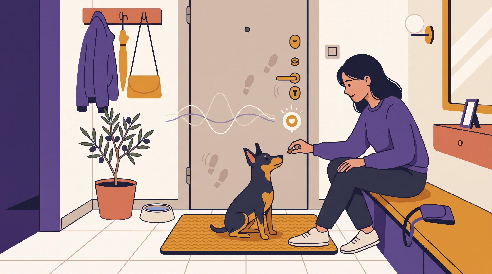

# **04\. Το «Σύνδρομο του Μικρού Σκύλου» (Μαλτέζ, Πομεράνιαν, Γιορκσάιρ, Πίνσερ): Γιατί γαβγίζουν τόσο πολύ;**

**Κατηγορία:** 02 - Φυλές, Ημίαιμα & Γενετικά Ένστικτα στο Διαμέρισμα  
**Προτεινόμενο URL:** /blog/mikrosoma-skylia-gavgisma-ekpaidefsi  
**Χρόνος ανάγνωσης:** 2 λεπτά

**Με μια ματιά (TL;DR)**

> * Το «σύνδρομο μικρού σκύλου» δεν είναι χρήσιμη διάγνωση.
> * Το μικρό μέγεθος δεν μειώνει την ανάγκη για χώρο και σεβασμό.
> * Αξιολογούμε γάβγισμα, φόβο και πιθανό πόνο όπως σε κάθε σκύλο.

## **Ένας κόσμος στο ύψος των ποδιών**

Χέρια κατεβαίνουν ξαφνικά από πάνω, άνθρωποι σκύβουν και μεγαλύτερα σκυλιά πλησιάζουν γρήγορα. Η συχνή αγκαλιά χωρίς προειδοποίηση μπορεί να αφαιρεί τη δυνατότητα επιλογής.

Αυτό δεν εξηγεί κάθε γάβγισμα. Το κίνητρο μπορεί να είναι ειδοποίηση, προσμονή, φόβος ή μάθηση. Παρατηρήστε πότε συμβαίνει, αντί να αποδίδετε χαρακτήρα σε Μαλτέζ, Πομεράνιαν ή οποιαδήποτε άλλη φυλή.

## **Μικρές αλλαγές που βοηθούν**

1. **Δώστε χώρο:** Ζητήστε από περαστικούς να μην σκύβουν αμέσως για χάδια.
2. **Προειδοποιήστε πριν τη μεταφορά:** Διδάξτε μια ήρεμη λέξη πριν τον σηκώσετε και ελέγξτε ότι ανέχεται τον χειρισμό. Σε πόνο ζητήστε κτηνιατρική καθοδήγηση.
3. **Επιλέξτε κατάλληλες επαφές:** Αποφύγετε ανεξέλεγκτο παιχνίδι με πολύ μεγαλύτερους σκύλους, ακόμη κι αν φαίνονται φιλικοί.
4. **Διδάξτε δεξιότητες στο έδαφος:** Εθελοντική μετακίνηση, ασφαλές σαμαράκι και επιβράβευση ήρεμης παρατήρησης από απόσταση.

## **Ούτε γελάμε ούτε μαλώνουμε**

Το γρύλισμα ενός μικρού σκύλου είναι εξίσου σημαντικό. Μην συνεχίζετε την επαφή επειδή το δάγκωμα φαίνεται λιγότερο επικίνδυνο.

Η αγκαλιά μπορεί να είναι χρήσιμη για ασφάλεια όταν είναι ανεκτή, αλλά δεν πρέπει να είναι ο μοναδικός τρόπος κάθε μετακίνησης. Αν το γάβγισμα εμφανιστεί ξαφνικά ή συνοδεύεται από ευαισθησία στο άγγιγμα, ελέγξτε πρώτα την υγεία.

**Διαβάστε επίσης:** [Συναίνεση στα χάδια](/blog/test-synainesis-sta-xadia-skylou).
