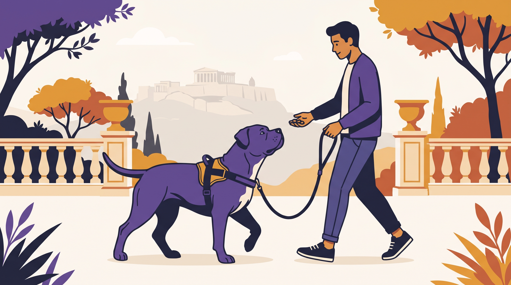

# **05\. Δυνατοί σκύλοι: Ασφαλής διαχείριση και εκπαίδευση χωρίς βία**

**Κατηγορία:** 02 - Φυλές, Ημίαιμα & Γενετικά Ένστικτα στο Διαμέρισμα  
**Προτεινόμενο URL:** /blog/ekpaidefsi-pitbull-rottweiler-xoris-via  
**Χρόνος ανάγνωσης:** 2 λεπτά

**Με μια ματιά (TL;DR)**

> * Η δύναμη αυξάνει την ανάγκη ασφαλούς διαχείρισης, όχι σκληρότητας.
> * Η φυλή δεν αρκεί για πρόβλεψη της ατομικής συμπεριφοράς.
> * Ο εξοπλισμός πρέπει να ταιριάζει στον σκύλο και στον συνοδό.

## **Ασφάλεια χωρίς στερεότυπα**

Ένας δυνατός σκύλος μπορεί να προκαλέσει τραυματισμό ακόμη και με ενθουσιώδες τράβηγμα. Αυτό απαιτεί προετοιμασία, αλλά δεν αποδεικνύει ότι Πίτμπουλ, Αμστάφ, Ροτβάιλερ ή άλλοι σκύλοι χρειάζονται πόνο για να μάθουν.

Αξιολογούμε ιστορικό, υγεία, αντιδράσεις και δυνατότητα διαχείρισης. Δεν θεωρούμε ούτε ότι η φυλή προδικάζει επιθετικότητα ούτε ότι η καλή ανατροφή εγγυάται μηδενικό κίνδυνο.

## **Πρακτικό πλάνο**

1. **Ελέγξτε εφαρμογή και αντοχή:** Κατάλληλο σαμαράκι, ασφαλή κουμπώματα και λουρί χωρίς φθορά. Ζητήστε βοήθεια αν δεν μπορείτε να κρατήσετε ασφαλή έλεγχο.
2. **Επιλέξτε χώρο εξάσκησης:** Ήσυχο σημείο με δυνατότητα απομάκρυνσης, όχι στενό πεζοδρόμιο γεμάτο ερεθίσματα.
3. **Διδάξτε χρήσιμες κινήσεις:** Αναστροφή, εθελοντική παραμονή και ανταπόκριση στο όνομα, με επιβράβευση και μικρή δυσκολία.
4. **Προετοιμάστε μέτρα πρόληψης:** Όπου χρειάζεται, θετική εξοικείωση με κατάλληλο φίμωτρο, χωρίς να αυξάνετε την έκθεση σε δύσκολες συναντήσεις.

## **Πότε ζητάμε βοήθεια**

Ιστορικό δαγκώματος, ανακατεύθυνση προς τον συνοδό ή αδυναμία συγκράτησης απαιτούν επαγγελματικό πλάνο πριν από νέες δοκιμές. Παιδιά δεν αναλαμβάνουν μόνα τη βόλτα δυνατού σκύλου.

Η ήρεμη συνεργασία χτίζεται με σαφή μάθηση και σωστή διαχείριση. Οι υποσχέσεις ότι ένα κολάρο θα δώσει «απόλυτο έλεγχο» δεν αντικαθιστούν την αξιολόγηση κινδύνου.

**Διαβάστε επίσης:** [Γιατί αποφεύγουμε εργαλεία τιμωρίας](/blog/giati-apofevgoume-pnixtes-ilektrika-kolara).
