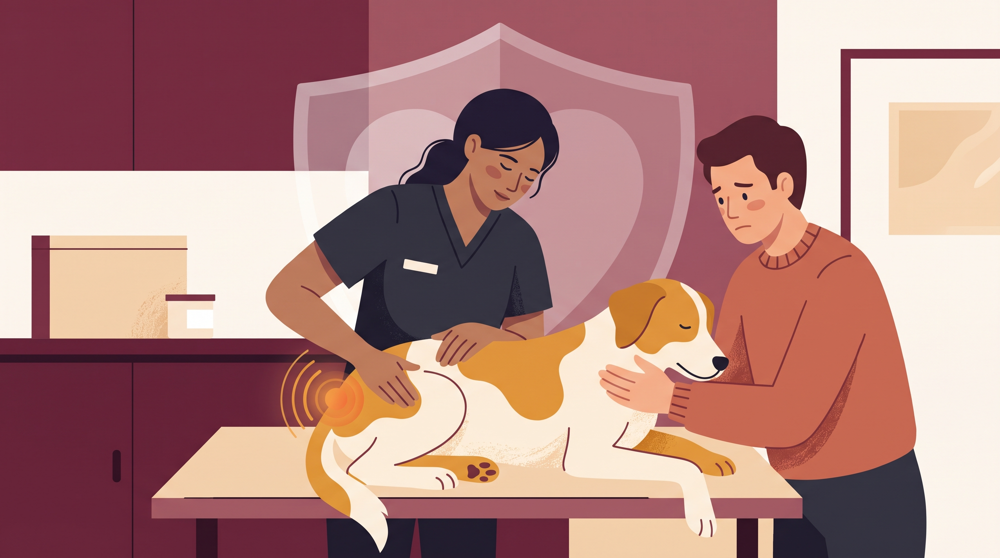

# **02\. Όταν ο πόνος μοιάζει με «κακή συμπεριφορά»: Πότε χρειάζεται κτηνιατρικός έλεγχος**

**Κατηγορία:** 03 - Ηλικία, Υγεία, Ορμόνες & Συμπεριφορά  
**Προτεινόμενο URL:** /blog/ponos-kai-epithetikotita-skylou  
**Χρόνος ανάγνωσης:** 2 λεπτά

**Με μια ματιά (TL;DR)**

> * Πόνος μπορεί να εμφανιστεί ως αποφυγή, ανησυχία ή αμυντική αντίδραση.
> * Η απουσία κλάματος δεν αποκλείει πρόβλημα υγείας.
> * Η ξαφνική αλλαγή χρειάζεται πρώτα κτηνιατρική διερεύνηση.

## **Όταν το «δεν θέλει» ίσως σημαίνει «δεν μπορεί»**

Σκύλος που δεν ανεβαίνει στον καναπέ, αποφεύγει το σαμαράκι ή γρυλίζει όταν τον μετακινείτε μπορεί να δυσφορεί. Δόντια, αυτιά, αρθρώσεις και άλλες παθήσεις μπορούν να επηρεάζουν την καθημερινότητα χωρίς προφανές τραύμα.

Δεν σημαίνει ότι κάθε επιθετική συμπεριφορά έχει αποκλειστικά ιατρική αιτία. Σημαίνει ότι δεν είναι ασφαλές να αυξάνουμε πίεση πριν εξετάσουμε αυτό το ενδεχόμενο.

## **Τι καταγράφουμε**

1. **Την αλλαγή:** Τι έκανε πριν και τι αποφεύγει τώρα; Υπήρξε πτώση, επέμβαση ή νέα δραστηριότητα;
2. **Κίνηση και ανάπαυση:** Δυσκολία έγερσης, αλλαγή στάσης, ανησυχία τη νύχτα ή αποφυγή σκαλών.
3. **Άλλες λειτουργίες:** Όρεξη, νερό, ούρηση, κόπρανα και αντοχή στη βόλτα.
4. **Αυθόρμητες εικόνες:** Ένα ασφαλές βίντεο βάδισης μπορεί να βοηθήσει. Μην προκαλείτε πόνο για να δείξετε την αντίδραση.

## **Μέχρι την εξέταση**

Αποφύγετε πιεστικούς χειρισμούς, έντονη άσκηση και επαφή παιδιών με σκύλο που δυσφορεί. Προσφέρετε άνετη ανάπαυση και αντιολισθητικό πάτημα.

Μην δίνετε ανθρώπινα παυσίπονα. Ορισμένα είναι επικίνδυνα για σκύλους. Δυσκολία αναπνοής, κατάρρευση, αδυναμία ούρησης ή έντονος οξύς πόνος χρειάζονται επείγουσα βοήθεια.

Μετά την αντιμετώπιση της υγείας μπορεί να χρειάζεται σταδιακή αποκατάσταση εμπιστοσύνης στους χειρισμούς. Η ανακούφιση και η συμπεριφορική υποστήριξη μπορούν να συμπληρώνουν η μία την άλλη.

**Διαβάστε επίσης:** [Συνεργατική φροντίδα](/blog/skylos-fovatai-ton-ktiniatro).
