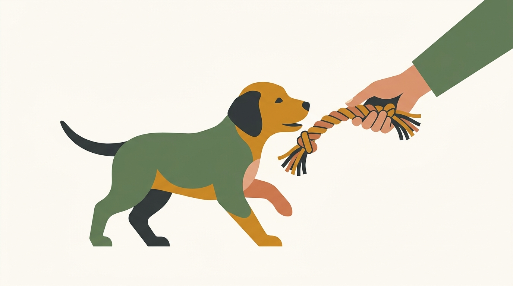

# **02\. Το κουτάβι μου με δαγκώνει συνέχεια στα χέρια και στα πατζάκια: Πώς σταματάμε τα δαγκώματα**

**Κατηγορία:** 04 - Κουτάβι στο Διαμέρισμα (Puppy Hub)  
**Προτεινόμενο URL:** /blog/koutavi-dagkonei-xeria-patzakia  
**Χρόνος ανάγνωσης:** 2 λεπτά

**Με μια ματιά (TL;DR)**

> * Το στόμα είναι εργαλείο εξερεύνησης, αλλά το δάγκωμα στα χέρια χρειάζεται ήρεμη διαχείριση.
> * Προσφέρουμε κατάλληλο παιχνίδι και μικρές παύσεις.
> * Ελέγχουμε κούραση, υπερδιέγερση και πιθανό πόνο.

## **Γιατί στοχεύει τα πατζάκια**

Τα κινούμενα πόδια μοιάζουν με πρόσκληση για κυνηγητό. Αν τρέχουμε, τραβάμε το ύφασμα ή κουνάμε τα χέρια, το παιχνίδι μπορεί να γίνει πιο συναρπαστικό. Η αλλαγή δοντιών μπορεί επίσης να αυξάνει την ανάγκη μάσησης. Αυτό δεν σημαίνει ότι το κουτάβι προσπαθεί να κυριαρχήσει.

Σημειώστε πότε εμφανίζεται η ένταση. Συμβαίνει μετά από πολλή δραστηριότητα, πριν τον ύπνο ή όταν το αγγίζετε σε συγκεκριμένο σημείο; Η απάντηση αλλάζει το πλάνο.

## **Τι κάνουμε εκείνη τη στιγμή**

1. **Προετοιμάστε εναλλακτική:** Έχετε μακρύ μαλακό παιχνίδι ώστε τα δόντια να μένουν μακριά από τα χέρια. Προσφέρετέ το πριν αρχίσει το κυνηγητό των ποδιών.
2. **Μειώστε την κίνηση:** Αν πιάσει το παντελόνι, σταματήστε όσο είναι ασφαλές και κατευθύνετε την προσοχή στο παιχνίδι. Μην τινάζετε το πόδι.
3. **Κάντε σύντομη παύση:** Αν επιμένει, περάστε ήρεμα πίσω από πορτάκι ασφαλείας. Επιστρέψτε σε χαμηλότερη ένταση, χωρίς να μετατρέψετε την απομάκρυνση σε παρατεταμένη απομόνωση.
4. **Καλύψτε την ανάγκη:** Προσφέρετε τουαλέτα, νερό και ευκαιρία ανάπαυσης. Επιλέξτε μάσημα κατάλληλο για ηλικία και δόντια, πάντα με επίβλεψη.

## **Όχι πόνος για να μάθει να μην πονάει**

Δεν κλείνουμε τη μουσούδα, δεν το αναποδογυρίζουμε και δεν το χτυπάμε. Τα δυνατά επιφωνήματα μπορεί να τρομάξουν ή να διεγείρουν περισσότερο ορισμένα κουτάβια.

Τα παιδιά δεν αναλαμβάνουν τη διαχείριση μόνα τους. Χρησιμοποιήστε φυσικό χωρισμό και ενήλικη επίβλεψη. Επίμονα βαθιά δαγκώματα, ακαμψία γύρω από τροφή ή αντίδραση στο άγγιγμα χρειάζονται κτηνιατρική και συμπεριφορική αξιολόγηση.

**Διαβάστε επίσης:** [Ύπνος και υπερένταση κουταβιού](/blog/ypnos-koutaviou-yperentasi-zoomies).
