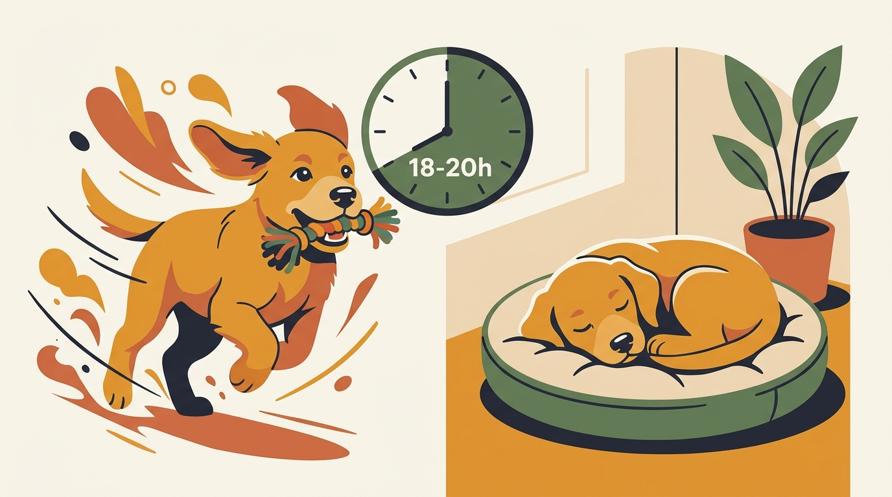

# **05\. Πόσο ύπνο χρειάζεται το κουτάβι και πότε η υπερένταση μοιάζει με «ανυπακοή»**

**Κατηγορία:** 04 - Κουτάβι στο Διαμέρισμα (Puppy Hub)  
**Προτεινόμενο URL:** /blog/ypnos-koutaviou-yperentasi-zoomies  
**Χρόνος ανάγνωσης:** 2 λεπτά

**Με μια ματιά (TL;DR)**

> * Τα κουτάβια χρειάζονται πολλές ευκαιρίες ύπνου, αλλά όχι όλα τις ίδιες ώρες.
> * Τα zoomies δεν αποδεικνύουν από μόνα τους έλλειψη ύπνου.
> * Η ξεκούραση υποστηρίζεται με ήσυχο περιβάλλον, όχι με αναγκαστικό περιορισμό.

## **Κούραση που μοιάζει με περισσότερη ενέργεια**

Ένα κουτάβι μπορεί μετά από έντονη ημέρα να δαγκώνει περισσότερο και να δυσκολεύεται να σταματήσει. Άλλες φορές τα σύντομα τρεξίματα είναι απλώς παιχνίδι ή εκτόνωση. Παρατηρούμε τι προηγήθηκε και πόσο εύκολα επιστρέφει σε ήρεμη δραστηριότητα.

Οι συχνές αναφορές σε «18–20 ώρες» είναι γενική περιγραφή για ορισμένα μικρά κουτάβια, όχι στόχος που επιβάλλουμε με χρονόμετρο. Η ηλικία, η υγεία και η ποιότητα της ανάπαυσης επηρεάζουν τις ανάγκες.

## **Οργανώστε μια μέρα με παύσεις**

1. **Καταγράψτε για λίγες ημέρες:** Σημειώστε ύπνο, παιχνίδι, εξόδους και ξεσπάσματα. Αναζητήστε μοτίβα χωρίς να ξυπνάτε το κουτάβι για να τηρηθεί το πρόγραμμα.
2. **Εναλλάξτε δραστηριότητα και ησυχία:** Μετά από τουαλέτα, σύντομη εξερεύνηση ή παιχνίδι, προσφέρετε ευκαιρία ανάπαυσης. Δεν χρειάζεται να γεμίζετε κάθε ξύπνια στιγμή με μάθημα.
3. **Προστατέψτε τη γωνιά του:** Μακριά από συνεχή περάσματα, με άνετη θερμοκρασία και νερό. Τα παιδιά και οι επισκέπτες δεν το ξυπνούν για χάδια.
4. **Χαμηλώστε σταδιακά τον ρυθμό:** Απομακρύνετε τα παιχνίδια κυνηγητού και δοκιμάστε ήρεμη συνύπαρξη. Μείνετε κοντά αν αυτό το βοηθά να χαλαρώσει.

## **Πότε δεν αρκεί η αλλαγή προγράμματος**

Αν δεν μπορεί να βολευτεί, ξυπνά με πόνο, αναπνέει δύσκολα ή παρουσιάζει απότομη αλλαγή ύπνου, μιλήστε με κτηνίατρο. Αν κοιμάται ασυνήθιστα πολύ και είναι νωθρό όταν ξυπνά, μην θεωρήσετε αυτόματα ότι «ξεκουράζεται σωστά».

Η επιτυχία φαίνεται στην ευκολότερη εναλλαγή ανάμεσα σε δραστηριότητα και ανάπαυση, όχι σε έναν υποχρεωτικό αριθμό ωρών.

**Διαβάστε επίσης:** [Δαγκώματα σε χέρια και πατζάκια](/blog/koutavi-dagkonei-xeria-patzakia).
