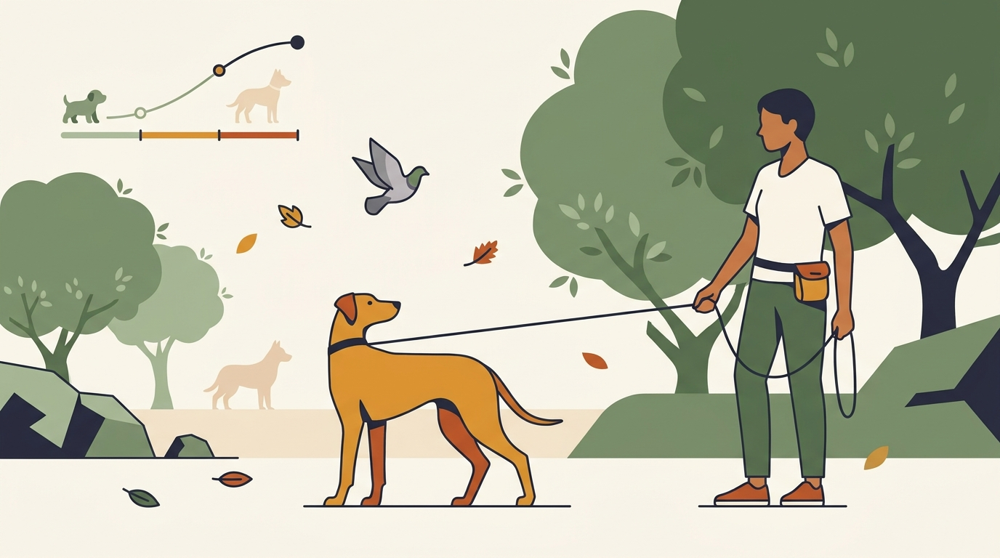

# **06\. Εφηβεία σκύλου: Γιατί ξαφνικά δυσκολεύεται με όσα είχε μάθει**

**Κατηγορία:** 04 - Κουτάβι στο Διαμέρισμα (Puppy Hub)  
**Προτεινόμενο URL:** /blog/efiveia-skylou-allagi-symperiforas  
**Χρόνος ανάγνωσης:** 2 λεπτά

**Με μια ματιά (TL;DR)**

> * Η εφηβεία δεν έχει ίδια αρχή και διάρκεια για όλους τους σκύλους.
> * Η δυσκολία συγκέντρωσης δεν σημαίνει ότι χάθηκε όλη η μάθηση.
> * Μειώνουμε τη δυσκολία και προστατεύουμε όσα δεν είναι ακόμη αξιόπιστα.

## **Γιατί το «έλα» λειτουργεί στο σπίτι αλλά όχι έξω**

Καθώς ο σκύλος αναπτύσσεται, το περιβάλλον και οι κοινωνικές επαφές μπορεί να αποκτούν μεγαλύτερη αξία. Αλλάζουν το σώμα, τα ενδιαφέροντα και οι αντιδράσεις του. Παράλληλα, μια δεξιότητα που μάθαμε στο σαλόνι δεν μεταφέρεται αυτόματα σε πλατεία γεμάτη μυρωδιές.

Η ηλικία δεν εξηγεί τα πάντα. Ξαφνική αποφυγή αγγίγματος, χωλότητα ή σοβαρή μεταβολή συμπεριφοράς χρειάζεται έλεγχο, όχι την ταμπέλα «εφηβικό πείσμα».

## **Επιστροφή σε εύκολες επιτυχίες**

1. **Κατεβάστε το επίπεδο:** Ζητήστε μια γνώριμη συμπεριφορά σε ήσυχο χώρο. Κάντε λίγες επαναλήψεις αντί για μακρύ μάθημα γεμάτο αποτυχίες.
2. **Πληρώστε την προσπάθεια:** Επιβραβεύστε το αυθόρμητο κοίταγμα και την επιστροφή. Μην μαλώνετε ποτέ επειδή άργησε να έρθει, αφού τελικά πλησίασε.
3. **Διαχειριστείτε την ελευθερία:** Χρησιμοποιήστε κατάλληλο μακρύ λουρί σε επιτρεπόμενο, ανοιχτό χώρο. Δεν δοκιμάζουμε την επαναφορά λυτά κοντά σε δρόμο.
4. **Κρατήστε ισορροπία:** Κατάλληλη κίνηση, όσφρηση, ήρεμη κοινωνική επαφή και ανάπαυση. Η προσπάθεια να τον εξαντλήσετε δεν αντικαθιστά τη μάθηση.

## **Τι κάνουμε στις δύσκολες εβδομάδες**

Αν αρχίσει να φοβάται κάτι γνώριμο, αυξήστε απόσταση και επαναφέρετε ήπιες θετικές εμπειρίες. Δεν τον σπρώχνουμε να «το ξεπεράσει». Αν αλλάζουν οι προτιμήσεις του για άλλους σκύλους, σεβαστείτε τις αντί να απαιτείτε παιχνίδι.

Συζητήστε θέματα αναπαραγωγής και στείρωσης με κτηνίατρο. Η στείρωση δεν αποτελεί γενική θεραπεία για εφηβική ένταση, φόβο ή δυσκολία συνεργασίας.

**Διαβάστε επίσης:** [Μακρύ λουρί με ασφάλεια](/blog/long-line-makry-louri-ekpaidefsi).
