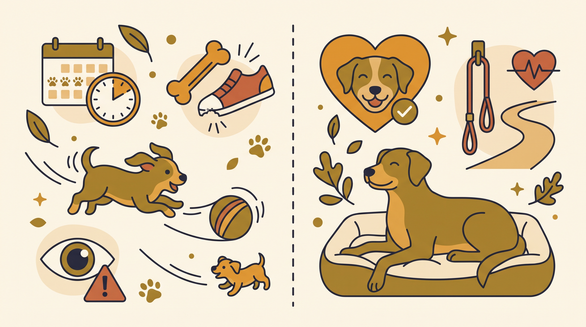

# **02\. Κουτάβι ή Ενήλικος Σκύλος; Ποιο ταιριάζει πραγματικά στο πρόγραμμά σας**

**Κατηγορία:** 04 - Πριν την Υιοθεσία (Επιλογή Σκύλου & Προετοιμασία)  
**Προτεινόμενο URL:** /blog/yiothesia-koutavi-i-enilikos-skylos  
**Χρόνος ανάγνωσης:** 2 λεπτά

**Με μια ματιά (TL;DR)**

> * Το κουτάβι χρειάζεται συχνή φροντίδα και πολλές μικρές ευκαιρίες μάθησης.
> * Ο ενήλικος δεν είναι αυτόματα εκπαιδευμένος ή εύκολος.
> * Επιλέγουμε με βάση το πραγματικό πρόγραμμα και τον συγκεκριμένο σκύλο.

## **Διαφορετικές απαιτήσεις**

Ένα κουτάβι χρειάζεται συχνές εξόδους τουαλέτας, διαχείριση δαγκώματος, κοινωνικοποίηση και υποστήριξη τη νύχτα. Δεν ταιριάζει εύκολα σε πρόγραμμα πολύωρης απουσίας χωρίς βοήθεια.

Ένας ενήλικος μπορεί να έχει πιο γνωστό μέγεθος και παρατηρημένες προτιμήσεις. Μπορεί όμως να χρειάζεται εκμάθηση μοναξιάς, τουαλέτας ή προσαρμογής στην πόλη. Η ηλικία δεν εγγυάται συναισθηματική ετοιμότητα.

## **Τέσσερις ερωτήσεις επιλογής**

1. **Πόση παρουσία μπορώ να προσφέρω;** Υπολογίστε και τις δύσκολες εργάσιμες ημέρες.
2. **Τι γνωρίζουμε από πραγματική παρατήρηση;** Στοιχεία από φιλοξενία σε σπίτι μπορεί να είναι χρήσιμα, χωρίς να προβλέπουν τα πάντα.
3. **Ποιο επίπεδο δραστηριότητας μπορώ να καλύψω;** Όχι τι θα θέλατε ιδανικά να κάνετε, αλλά τι κάνετε σταθερά.
4. **Ποια υποστήριξη διαθέτω;** Κτηνίατρος, εκπαιδευτής και έμπιστος φροντιστής όταν χρειάζεται.

## **Αποφύγετε δύο μύθους**

Δεν είναι βέβαιο ότι ένα κουτάβι θα γίνει ακριβώς όπως το φαντάζεστε επειδή θα το μεγαλώσετε εσείς. Ούτε ένας ενήλικος σκύλος έχει «τελειώσει» τη δυνατότητα μάθησης.

Συναντήστε τον υποψήφιο σκύλο περισσότερες από μία φορές, όπου είναι δυνατό, και συζητήστε ειλικρινά τις ανάγκες σας. Επιλέξτε συμβατότητα και διαθέσιμη φροντίδα, όχι την υπόσχεση μιας ηλικίας χωρίς δυσκολίες.

**Διαβάστε επίσης:** [Εκπαίδευση ενήλικου σκύλου](/blog/ekpaidefsi-enilikou-skylou-ilikia).
