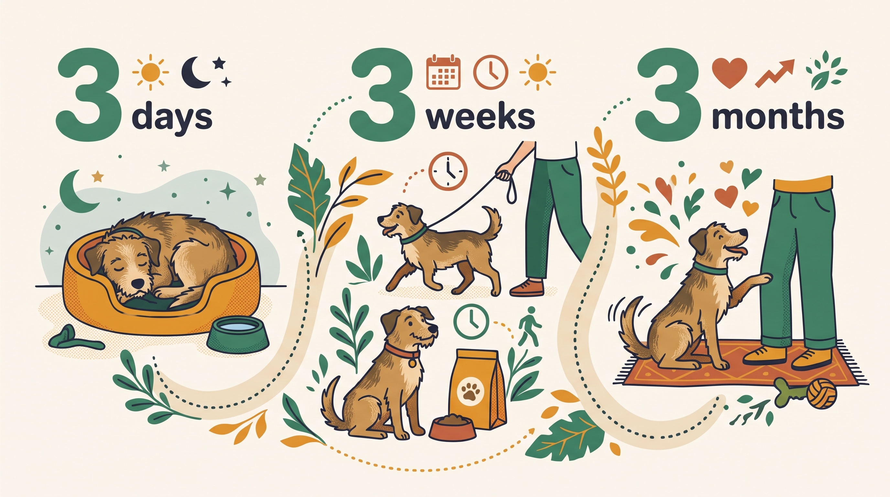

# **02\. Ο κανόνας 3-3-3 στην υιοθεσία: Χρήσιμη υπενθύμιση, όχι χρονοδιάγραμμα**

**Κατηγορία:** 05 - Η Μετάβαση μετά την Υιοθεσία (Αποσυμπίεση & Δέσιμο)  
**Προτεινόμενο URL:** /blog/kanonas-3-3-3-yiothesia-adespotou-skylou  
**Χρόνος ανάγνωσης:** 2 λεπτά

**Με μια ματιά (TL;DR)**

> * Οι τρεις ημέρες, εβδομάδες και μήνες είναι δημοφιλής υπενθύμιση υπομονής.
> * Δεν αποτελούν επιστημονικά επικυρωμένα στάδια προσαρμογής.
> * Αν υπάρχει σοβαρή δυσφορία, δεν περιμένουμε να περάσει ένα αυθαίρετο διάστημα.

## **Τι μπορεί να κρατήσει κανείς από τον κανόνα**

Η βασική ιδέα είναι χρήσιμη: η συμπεριφορά αλλάζει καθώς ο σκύλος γνωρίζει το περιβάλλον. Δεν βλέπουμε τα πάντα την πρώτη ημέρα και χρειάζεται χρόνος για συνήθειες και εμπιστοσύνη.

Το πρόβλημα αρχίζει όταν υποσχόμαστε ότι σε τρεις μήνες κάθε σκύλος θα νιώθει «σαν στο σπίτι του». Υγεία, ιστορικό, περιβάλλον και διαθέσιμη υποστήριξη διαφέρουν σημαντικά.

## **Μετρήστε άνεση, όχι ημερομηνίες**

1. **Βασικές λειτουργίες:** Τρώει, πίνει και πηγαίνει τουαλέτα φυσιολογικά;
2. **Ανάπαυση:** Μπορεί να κοιμηθεί και να αλλάξει θέση χωρίς διαρκή επαγρύπνηση;
3. **Επιλογές:** Εξερευνά, απομακρύνεται και πλησιάζει εθελοντικά;
4. **Επαναφορά:** Μετά από ήπιο ερέθισμα επιστρέφει σταδιακά σε γνώριμη δραστηριότητα;

Κρατήστε σύντομες σημειώσεις. Η πρόοδος μπορεί να έχει διακυμάνσεις και δεν είναι απαραίτητα γραμμική.

## **Πότε ζητάμε βοήθεια νωρίτερα**

Επίμονη ανορεξία, πόνος, πανικός, απόπειρες διαφυγής ή κίνδυνος δαγκώματος απαιτούν έγκαιρη αξιολόγηση. Ο κανόνας δεν δικαιολογεί αναμονή χωρίς υποστήριξη.

Μην αυξάνετε τις απαιτήσεις επειδή «πέρασαν οι τρεις εβδομάδες». Προχωρήστε όταν ο συγκεκριμένος σκύλος δείχνει άνεση και υπάρχει ασφαλές πλάνο. Μια μικρή βελτίωση στον ύπνο ή στην εθελοντική προσέγγιση είναι πιο χρήσιμη πληροφορία από την ημερομηνία του ημερολογίου.

**Διαβάστε επίσης:** [Χτίσιμο εμπιστοσύνης](/blog/pos-xtizetai-i-empistosyni-me-foviko-skylo).
