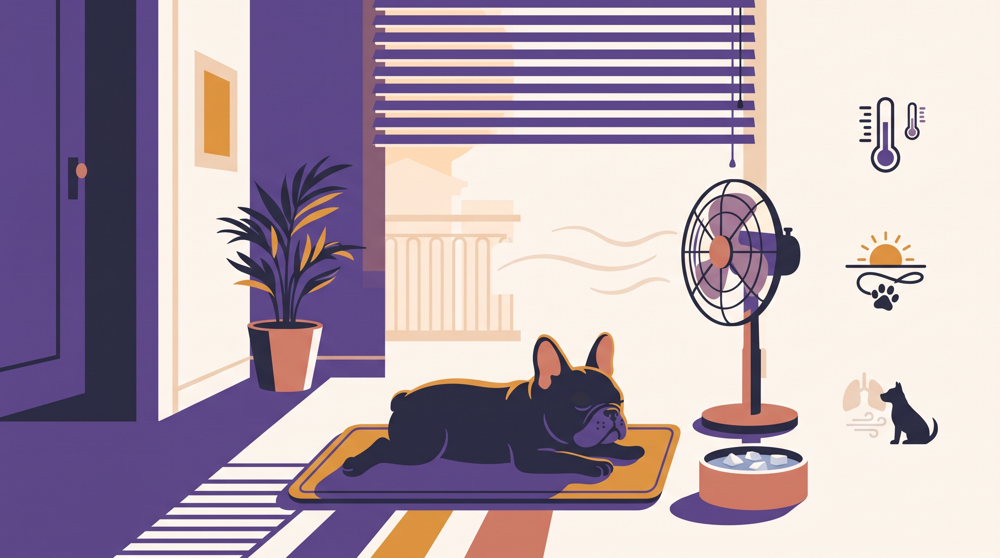

# **06\. Φρεντς Μπουλντόγκ & Παγκ (Βραχυκεφαλικές φυλές): Εκπαίδευση, «πείσμα» και προσοχή στη ζέστη της Αθήνας**

**Κατηγορία:** 09 - Φυλές, Ημίαιμα & Γενετικά Ένστικτα στο Διαμέρισμα  
**Προτεινόμενο URL:** /blog/french-bulldog-pug-ekpaidefsi  
**Χρόνος ανάγνωσης:** 2 λεπτά

**Με μια ματιά (TL;DR)**

> * Θορυβώδης αναπνοή και δυσκολία κίνησης δεν είναι απλώς «πείσμα».
> * Η ζέστη μπορεί να γίνει ιδιαίτερα επικίνδυνη.
> * Το πρόγραμμα βασίζεται στην κτηνιατρική εκτίμηση και στην πραγματική αντοχή.

## **Όταν η άρνηση είναι σωματική δυσκολία**

Φρεντς Μπουλντόγκ, Παγκ και άλλοι βραχυκεφαλικοί σκύλοι μπορεί να έχουν αναπνευστικά προβλήματα. Δεν θεωρούμε το έντονο ροχαλητό, τη δυσανεξία στην άσκηση ή την κοπιαστική αναπνοή χαριτωμένα χαρακτηριστικά που δεν χρειάζονται έλεγχο.

Κανένα άρθρο εκπαίδευσης δεν μπορεί να εκτιμήσει την ανατομία ή τη σοβαρότητα μιας πάθησης. Μιλήστε με κτηνίατρο για συμπτώματα, βάρος και κατάλληλη δραστηριότητα.

## **Προσαρμόστε τη μέρα**

1. **Ελέγξτε συνθήκες, όχι μόνο ώρα:** Πρωί και βράδυ μπορεί επίσης να έχουν υψηλή θερμοκρασία ή υγρασία.
2. **Κρατήστε τις συνεδρίες σύντομες:** Εύκολη μάθηση σε δροσερό χώρο με διαλείμματα και νερό.
3. **Αποφύγετε την πίεση στον λαιμό:** Ζητήστε κατάλληλη εφαρμογή εξοπλισμού. Μην χρησιμοποιείτε φίμωτρο που περιορίζει το λαχάνιασμα.
4. **Δώστε ήπια απασχόληση:** Απλές αναζητήσεις και ήρεμη εξερεύνηση, χωρίς προσπάθεια εξάντλησης.

## **Επείγοντα σημάδια**

Δυσκολία αναπνοής, κατάρρευση, έντονη αδυναμία ή αλλαγή χρώματος ούλων απαιτούν άμεση κτηνιατρική βοήθεια. Σε υποψία υπερθέρμανσης μεταφέρετε σε δροσερό χώρο, αρχίστε ψύξη με νερό και επικοινωνήστε αμέσως με κτηνίατρο για μεταφορά.

Μην περιμένετε να «πάρει ανάσα» για πολλή ώρα και μην τον πιέζετε να ολοκληρώσει τη βόλτα. Στόχος είναι η άνεση, όχι μια επίδοση που ταιριάζει σε άλλον σκύλο.

**Διαβάστε επίσης:** [Καύσωνας και ασφαλής καθημερινότητα](/blog/volta-skylou-ston-kafsona-kalokairi).
