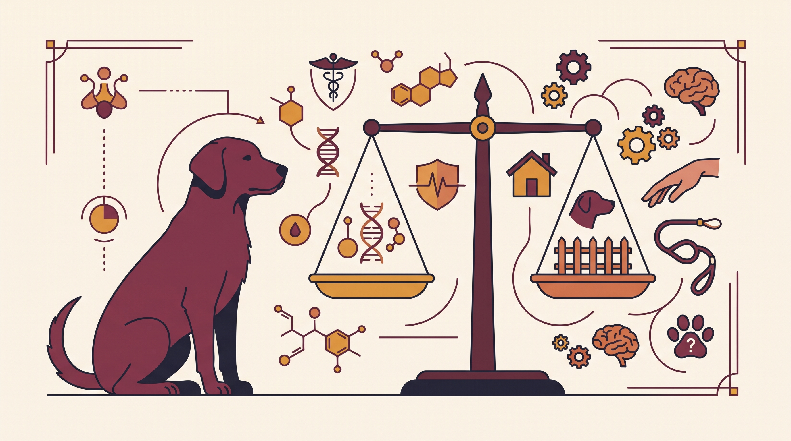

# **01\. Στείρωση και συμπεριφορά σκύλου: Τι μπορεί να αλλάξει και τι όχι**

**Κατηγορία:** 11 - Ηλικία, Υγεία, Ορμόνες & Συμπεριφορά  
**Προτεινόμενο URL:** /blog/steirosi-skylou-allagi-symperiforas  
**Χρόνος ανάγνωσης:** 2 λεπτά

**Με μια ματιά (TL;DR)**

> * Η στείρωση δεν είναι γενική θεραπεία φόβου, γαβγίσματος ή επιθετικότητας.
> * Ορισμένες ορμονοεξαρτώμενες συμπεριφορές μπορεί να αλλάξουν, όχι με βέβαιο αποτέλεσμα.
> * Η απόφαση χρειάζεται εξατομικευμένη κτηνιατρική συζήτηση.

## **Τι μπορεί και τι δεν μπορεί να προβλεφθεί**

Αναζήτηση συντρόφου, περιπλάνηση ή ορισμένες μορφές σημαδέματος μπορεί να έχουν ορμονική συνιστώσα. Όμως η μάθηση και το περιβάλλον παραμένουν σημαντικά. Το καβάλημα, για παράδειγμα, μπορεί επίσης να σχετίζεται με διέγερση.

Οι επιδράσεις διαφέρουν ανά φύλο, ηλικία, κατάσταση υγείας και συγκεκριμένη συμπεριφορά. Δεν είναι σωστό να υποσχόμαστε ούτε ότι «θα ηρεμήσει» ούτε ότι «θα γίνει σίγουρα πιο φοβικός».

## **Προετοιμάστε τη συζήτηση**

1. **Περιγράψτε συγκεκριμένα το πρόβλημα:** Πότε εμφανίζεται, πόσο συχνά και τι συνέπειες έχει.
2. **Δώστε πλήρες ιστορικό:** Υγεία, προηγούμενες αλλαγές, φάρμακα και, όπου αφορά, σχέση με αναπαραγωγικούς κύκλους.
3. **Ρωτήστε για οφέλη και κινδύνους:** Χρόνος επέμβασης, ανάρρωση, πρόληψη ανεπιθύμητης αναπαραγωγής και ισχύουσες υποχρεώσεις.
4. **Κρατήστε χωριστό συμπεριφορικό πλάνο:** Διαχείριση, εκπαίδευση και υποστήριξη συνεχίζονται ανεξάρτητα από την επέμβαση.

## **Μετά την επέμβαση**

Πόνος, περιορισμός δραστηριότητας και αλλαγή ρουτίνας μπορεί να επηρεάσουν προσωρινά τη συμπεριφορά. Ακολουθήστε τις οδηγίες ανάρρωσης και επικοινωνήστε με την κτηνιατρική ομάδα για ανησυχητικά συμπτώματα.

Μην δοκιμάζετε την «καινούργια συμπεριφορά» με δύσκολες συναντήσεις αμέσως μετά. Αν υπάρχει ιστορικό δαγκώματος, τα μέτρα ασφάλειας παραμένουν. Κανένα αποτέλεσμα επέμβασης δεν αντικαθιστά την ατομική αξιολόγηση κινδύνου.

**Διαβάστε επίσης:** [Καβάλημα και διέγερση](/blog/giati-o-skylos-kavalaei-podia-skylia).
