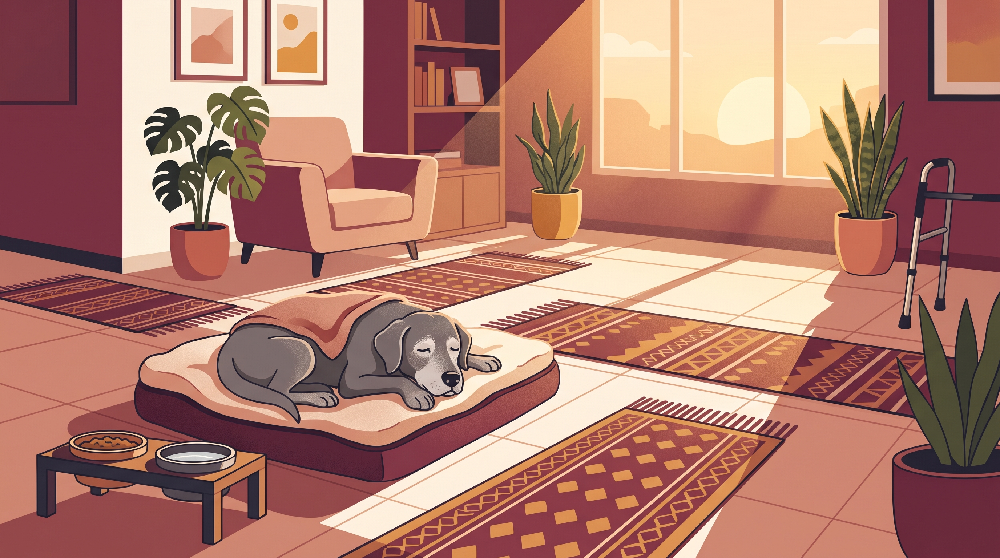

# **03\. Υπερήλικος Σκύλος (Senior Dog): Πώς να διαχειριστείτε την άνοια, το νυχτερινό κλάμα και την απώλεια όρασης/ακοής**

**Κατηγορία:** 11 - Ηλικία, Υγεία, Ορμόνες & Συμπεριφορά  
**Προτεινόμενο URL:** /blog/yperilikos-skylos-anoia-klama-vrady  
**Χρόνος ανάγνωσης:** 2 λεπτά

**Με μια ματιά (TL;DR)**

> * Νυχτερινό κλάμα και αποπροσανατολισμός δεν είναι αυτόματα «φυσιολογικά γηρατειά».
> * Πόνος, αισθητηριακές αλλαγές και γνωστική δυσλειτουργία χρειάζονται διερεύνηση.
> * Προσαρμόζουμε το περιβάλλον αντί να απαιτούμε παλιές επιδόσεις.

## **Πρώτα αποκλείουμε αντιμετωπίσιμες αιτίες**

Ένας ηλικιωμένος σκύλος μπορεί να κοιμάται διαφορετικά, να χρειάζεται συχνότερη τουαλέτα ή να δυσκολεύεται σε σκοτεινό διάδρομο. Παρόμοια σημάδια εμφανίζονται σε διαφορετικές παθήσεις. Η διάγνωση γνωστικής δυσλειτουργίας δεν γίνεται μόνο επειδή είναι μεγάλος.

Καταγράψτε αλλαγές και προγραμματίστε κτηνιατρικό έλεγχο. Ξαφνικός αποπροσανατολισμός ή αιφνίδια απώλεια όρασης χρειάζεται άμεση επικοινωνία.

## **Κάντε το σπίτι πιο εύκολο**

1. **Σταθερές διαδρομές:** Μην μετακινείτε συνέχεια έπιπλα. Ασφαλίστε σκάλες και επικίνδυνα σημεία.
2. **Καλύτερο πάτημα και φωτισμός:** Αντιολισθητικά χαλάκια και ήπιο νυχτερινό φως βοηθούν όταν είναι κατάλληλα για τον σκύλο.
3. **Προβλέψιμη φροντίδα:** Συχνότερες σύντομες έξοδοι, άνετο κρεβάτι και εύκολη πρόσβαση σε νερό.
4. **Ήρεμη επικοινωνία:** Πλησιάστε ώστε να σας αντιληφθεί. Αν ακούει λιγότερο, χρησιμοποιήστε ορατά σήματα και μην τον ξαφνιάζετε αγγίζοντας από πίσω.

## **Νοητική απασχόληση χωρίς πίεση**

Απλές αναζητήσεις τροφής και γνώριμες μικρές ασκήσεις μπορούν να διατηρούν ενδιαφέρον, εφόσον δεν κουράζουν ή πονάνε. Δεν χρειάζεται νέο δύσκολο παζλ κάθε ημέρα.

Σε νυχτερινή ανησυχία ελέγξτε ανάγκες και άνεση, αντί να μαλώνετε. Συζητήστε με τον κτηνίατρο ύπνο, πόνο, διατροφή και ποιότητα ζωής. Οι αλλαγές του σπιτιού υποστηρίζουν, αλλά δεν αντικαθιστούν την κατάλληλη θεραπεία.

**Διαβάστε επίσης:** [Πόνος και συμπεριφορά](/blog/ponos-kai-epithetikotita-skylou).
