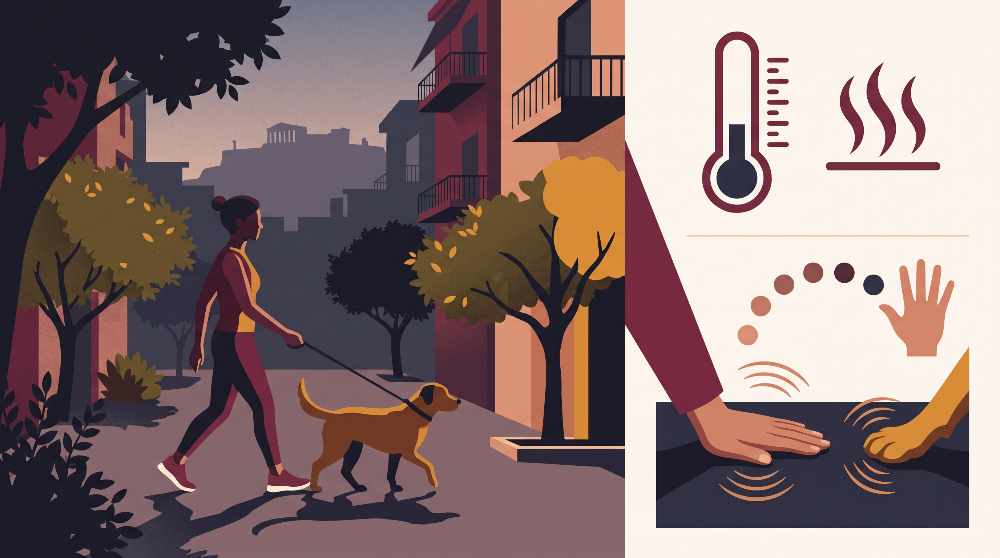

# **04\. Καύσωνας στην Αθήνα: Πώς προσαρμόζουμε τη βόλτα και προστατεύουμε τον σκύλο**

**Κατηγορία:** 11 - Ηλικία, Υγεία, Ορμόνες & Συμπεριφορά  
**Προτεινόμενο URL:** /blog/volta-skylou-ston-kafsona-kalokairi  
**Χρόνος ανάγνωσης:** 2 λεπτά

**Με μια ματιά (TL;DR)**

> * Δεν υπάρχει μία θερμοκρασία ασφαλής για κάθε σκύλο.
> * Η άσφαλτος και η υγρασία μπορεί να παραμένουν επικίνδυνες και το βράδυ.
> * Υποψία θερμοπληξίας απαιτεί άμεση ψύξη και κτηνιατρική βοήθεια.

## **Ελέγχουμε συνθήκες, όχι ημερολόγιο**

Στην Αθήνα, ζεστό πεζοδρόμιο, έντονη υγρασία και έλλειψη σκιάς αυξάνουν τη δυσκολία. Ηλικιωμένοι, υπέρβαροι, βραχυκεφαλικοί σκύλοι και ζώα με παθήσεις μπορεί να κινδυνεύουν νωρίτερα.

Αν το έδαφος είναι πολύ ζεστό για το χέρι σας, είναι ακατάλληλο για πατούσες. Το αντίθετο όμως δεν εγγυάται ασφαλή άσκηση: το «τεστ πέντε δευτερολέπτων» δεν αξιολογεί τη συνολική θερμική επιβάρυνση.

## **Προσαρμόστε τη μέρα**

1. **Επιλέξτε τις πιο δροσερές συνθήκες:** Σύντομες έξοδοι ανάγκης αντί για έντονη άσκηση.
2. **Προσφέρετε δροσερό εσωτερικό χώρο:** Νερό, κατάλληλο αερισμό ή κλιματισμό και δυνατότητα επιλογής θέσης.
3. **Κρατήστε ήπια απασχόληση:** Μικρές αναζητήσεις και γνώριμα παιχνίδια, όχι προσπάθεια εξάντλησης.
4. **Μην αφήνετε σκύλο σε αυτοκίνητο:** Σκιά και μισάνοιχτο παράθυρο δεν αρκούν.

## **Αν υποψιάζεστε θερμοπληξία**

Έντονο λαχάνιασμα, σάλια, αδυναμία, εμετός, σύγχυση ή κατάρρευση είναι ανησυχητικά. Μετακινήστε σε δροσερό σημείο, αρχίστε να βρέχετε το σώμα με νερό βρύσης και καλέστε αμέσως κτηνίατρο. Μην καλύπτετε το σώμα με βρεγμένες πετσέτες που παγιδεύουν θερμότητα.

Ξεκινήστε ψύξη άμεσα και οργανώστε επείγουσα μεταφορά με αερισμό ή κλιματισμό. Μην πιέζετε να πιει και μην περιμένετε να δείτε αν «συνήλθε». Ακόμη και φαινομενική βελτίωση χρειάζεται εξέταση.

**Πηγή:** [Blue Cross, κίνδυνοι καύσωνα για σκύλους](https://www.bluecross.org.uk/advice/dog/how-to-keep-dogs-cool-in-the-summer-heat).

**Διαβάστε επίσης:** [Βραχυκεφαλικοί σκύλοι](/blog/french-bulldog-pug-ekpaidefsi).
