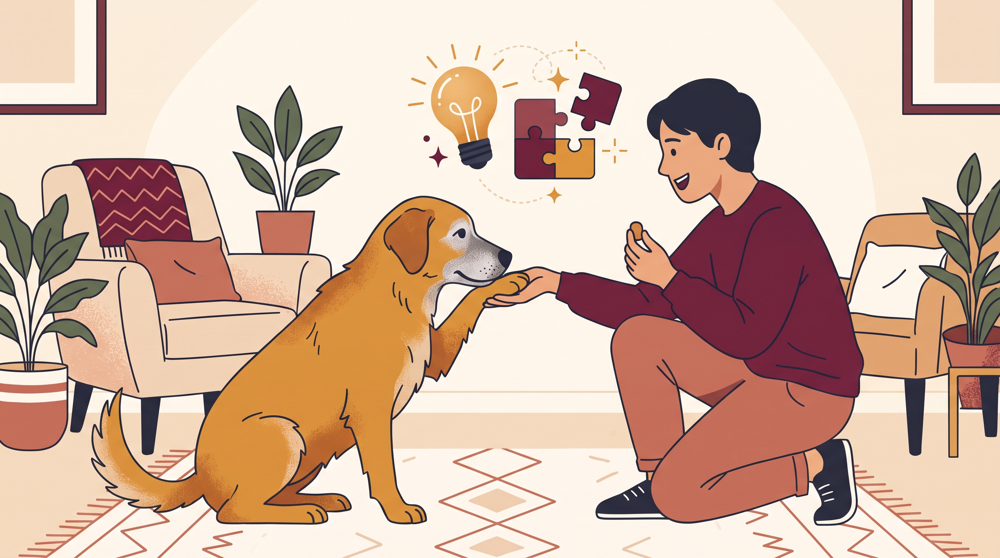

# **06\. «Είναι 5 χρονών, εκπαιδεύεται τώρα;» Πώς μαθαίνει ο εγκέφαλος του ενήλικου σκύλου**

**Κατηγορία:** 11 - Ηλικία, Υγεία, Ορμόνες & Συμπεριφορά  
**Προτεινόμενο URL:** /blog/ekpaidefsi-enilikou-skylou-ilikia  
**Χρόνος ανάγνωσης:** 2 λεπτά

**Με μια ματιά (TL;DR)**

> * Οι ενήλικοι σκύλοι μπορούν να μαθαίνουν νέες δεξιότητες.
> * Παλιές συνήθειες χρειάζονται νέο πλαίσιο και επανάληψη.
> * Υγεία και αισθητηριακές αλλαγές καθορίζουν τον τρόπο εξάσκησης.

## **Δεν είναι «πολύ αργά»**

Ένας σκύλος πέντε, οκτώ ή περισσότερων ετών δεν έχει χάσει αυτομάτως τη δυνατότητα μάθησης. Μπορεί όμως να έχει πολυετές ιστορικό ενίσχυσης μιας συνήθειας, διαφορετική αντοχή ή δυσκολία ακοής και όρασης.

Δεν συγκρίνουμε την ταχύτητά του με κουτάβι και δεν θεωρούμε κάθε καθυστέρηση πείσμα. Η εκπαίδευση χρειάζεται να έχει σαφή πρακτικό στόχο: πιο άνετη βόλτα, ασφαλή μετακίνηση ή ευκολότερη φροντίδα.

## **Ξεκινήστε με μια χρήσιμη δεξιότητα**

1. **Ελέγξτε τη σωματική άνεση:** Αν δυσκολεύεται να καθίσει ή να ξαπλώσει, μην επιμένετε πριν αξιολογηθεί πιθανός πόνος.
2. **Διαλέξτε μικρό στόχο:** Για παράδειγμα, να σας κοιτάζει όταν ακούει το όνομά του σε ήσυχο δωμάτιο.
3. **Επιβραβεύστε αμέσως:** Χρησιμοποιήστε τροφή, παιχνίδι ή πρόσβαση σε κάτι ευχάριστο, ανάλογα με τις προτιμήσεις του.
4. **Μεταφέρετε τη μάθηση σταδιακά:** Από το σπίτι στην είσοδο και έπειτα σε ήσυχο εξωτερικό σημείο. Κάθε νέο περιβάλλον αυξάνει τη δυσκολία.

## **Μικρή διάρκεια, καθαρή επικοινωνία**

Λίγες καλές επαναλήψεις είναι προτιμότερες από συνεχή επανάληψη εντολών. Αν δεν ανταποκρίνεται, ελέγξτε αν καταλαβαίνει το σήμα και αν το περιβάλλον είναι κατάλληλο.

Σε απότομη απώλεια γνώριμων δεξιοτήτων ζητήστε κτηνιατρικό έλεγχο. Σε χρόνιο φόβο ή επιθετική συμπεριφορά, η ηλικία δεν αποκλείει βοήθεια, αλλά απαιτείται εξατομικευμένη αξιολόγηση.

**Διαβάστε επίσης:** [Πώς λειτουργεί η επιβράβευση](/blog/lixoudies-stin-ekpaidefsi-skylon).
