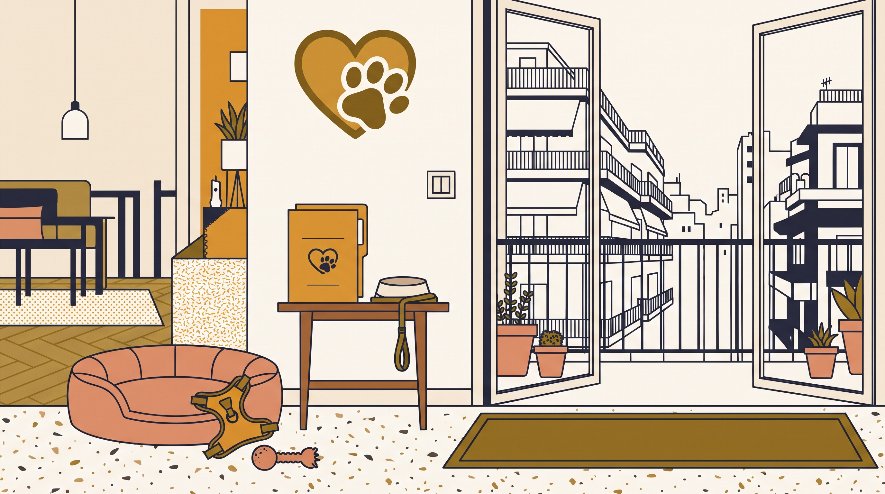

# **Πυλώνας 14: Πριν την Υιοθεσία (Επιλογή Σκύλου & Προετοιμασία)**

**Εισαγωγή:** Η επιτυχημένη συμβίωση ξεκινάει πριν καν περάσει ο σκύλος το κατώφλι του σπιτιού. Αυτός ο πυλώνας καθοδηγεί τους υποψήφιους κηδεμόνες στην υπεύθυνη επιλογή σκύλου που ταιριάζει στον τρόπο ζωής τους και στη σωστή προετοιμασία του διαμερίσματος.  
**Συνδεδεμένη Υπηρεσία:** /ypiresies/yiothesia-kai-proti-prosarmogi

## **Πίνακας Περιεχομένων (Άρθρα & Οδηγοί)**

> * **1\. Θέλω να υιοθετήσω σκύλο στην Αθήνα: Το ειλικρινές τεστ ετοιμότητας (Χρόνος, Κόστος & Υποχρεώσεις)**  
>   *URL:* /blog/thelo-na-yiothetiso-skylo-test-etoimotitas  
>   *Περιγραφή:* Μια ρεαλιστική ματιά στις καθημερινές ανάγκες, το οικονομικό κόστος και τις αλλαγές στο πρόγραμμα ενός εργαζόμενου στην πόλη.  
> * **2\. Κουτάβι ή Ενήλικος Σκύλος; Ποιο ταιριάζει πραγματικά στο πρόγραμμά σας**  
>   *URL:* /blog/yiothesia-koutavi-i-enilikos-skylos  
>   *Περιγραφή:* Οι διαφορετικές απαιτήσεις κουταβιού και ενήλικου σκύλου, χωρίς να θεωρούμε καμία ηλικία αυτόματα εύκολη επιλογή.  
> * **3\. Πώς να επιλέξετε τον σωστό σκύλο από καταφύγιο ή φιλοζωική: 7 ερωτήσεις που πρέπει να κάνετε**  
>   *URL:* /blog/pos-na-epilekso-skylo-apo-katafygio-filozoiki  
>   *Περιγραφή:* Πώς αξιολογούμε τα επίπεδα ενέργειας και το ιστορικό του ζώου, πέρα από μια συγκινητική φωτογραφία στα social media.  
> * **4\. Η Πρώτη Συνάντηση με τον υποψήφιο σκύλο: Τι να παρατηρήσετε στη συμπεριφορά του**  
>   *URL:* /blog/proti-synantisi-me-skylo-pros-yiothesia  
>   *Περιγραφή:* Πώς συμπεριφερόμαστε στο ραντεβού γνωριμίας και ποια σημάδια δείχνουν τη συμβατότητα του σκύλου με το περιβάλλον μας.  
> * **5\. Τι να αγοράσετε ΠΡΙΝ έρθει ο σκύλος στο σπίτι (και τι είναι πεταμένα λεφτά)**  
>   *URL:* /blog/lista-agoron-gia-neo-skylo-eksoplismos  
>   *Περιγραφή:* Η πλήρης λίστα απαραίτητου, dog-friendly εξοπλισμού (σαμαράκι Υ, σταθερό λουρί, κρεβάτι, παιχνίδια μάσησης).  
> * **6\. Dog-proofing στο διαμέρισμα: Ασφαλέστερο σπίτι και μπαλκόνι**  
>   *URL:* /blog/dog-proofing-diamerisma-asfaleia-mpalkoni  
>   *Περιγραφή:* Ασφάλιση εξόδων, απομάκρυνση επικίνδυνων αντικειμένων και σταθερή ζώνη ανάπαυσης. Κανένα μέτρο δεν καταργεί την ανάγκη επίβλεψης.
