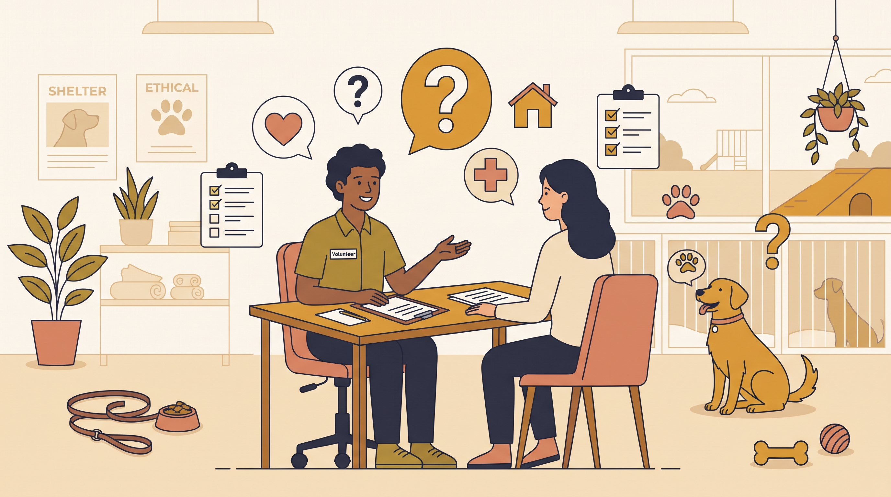

# **03\. Πώς να επιλέξετε τον σωστό σκύλο από καταφύγιο ή φιλοζωική: 7 ερωτήσεις που πρέπει να κάνετε**

**Κατηγορία:** 14 - Πριν την Υιοθεσία (Επιλογή Σκύλου & Προετοιμασία)  
**Προτεινόμενο URL:** /blog/pos-na-epilekso-skylo-apo-katafygio-filozoiki  
**Χρόνος ανάγνωσης:** 2 λεπτά

**Με μια ματιά (TL;DR)**

> * Ζητάμε συγκεκριμένες παρατηρήσεις, όχι μόνο χαρακτηρισμούς.
> * Το «δεν γνωρίζουμε» είναι χρήσιμη και έντιμη πληροφορία.
> * Η συμπεριφορά στο καταφύγιο δεν προβλέπει πλήρως τη ζωή στο σπίτι.

## **Οι ερωτήσεις που βοηθούν την απόφαση**

1. **Τι γνωρίζουμε για την υγεία;** Εξετάσεις, αγωγές, εμβολιασμοί και ανάγκες επανελέγχου.
2. **Σε ποιο περιβάλλον έχει παρατηρηθεί;** Καταφύγιο, δρόμος ή φιλοξενία σε σπίτι;
3. **Πώς ανταποκρίνεται σε ανθρώπους;** Ζητήστε παραδείγματα και ενημέρωση για οποιοδήποτε δάγκωμα ή φύλαξη πόρων.
4. **Τι γνωρίζουμε για άλλα ζώα;** Υπό ποιες συνθήκες έγιναν επαφές και με ποια διαχείριση;
5. **Πώς τα πηγαίνει με μεταφορά και χειρισμούς;** Λουρί, αυτοκίνητο, σαμαράκι και κτηνιατρική φροντίδα.
6. **Έχει μείνει μόνος σε σπίτι;** Για πόσο και με ποια παρατήρηση; Η σιωπή σε κλουβί δεν απαντά αυτή την ερώτηση.
7. **Ποια υποστήριξη προσφέρεται μετά;** Διαδικασία υιοθεσίας, έγγραφα, επικοινωνία και συμφωνημένο πλάνο αν εμφανιστούν δυσκολίες.

## **Πώς αξιολογούμε τις απαντήσεις**

Σημειώστε τι είναι επιβεβαιωμένο και τι εκτίμηση. Η λέξη «φιλικός» δεν αποδεικνύει συμβατότητα με μικρά παιδιά ή γάτες. Η λέξη «ήρεμος» μπορεί να περιγράφει μόνο μία στιγμή.

Μοιραστείτε επίσης το δικό σας πρόγραμμα, τις σκάλες, άλλα ζώα και περιορισμούς. Η σωστή αντιστοίχιση απαιτεί ειλικρίνεια και από τις δύο πλευρές.

## **Μην κάνετε επικίνδυνα τεστ**

Δεν παίρνουμε μπολ, δεν πιέζουμε αγκαλιά και δεν φέρνουμε γάτα για να ελέγξουμε αντιδράσεις. Ζητήστε καθοδηγούμενη γνωριμία και πρόσθετη επαγγελματική αξιολόγηση όπου χρειάζεται.

**Διαβάστε επίσης:** [Η πρώτη συνάντηση](/blog/proti-synantisi-me-skylo-pros-yiothesia).
