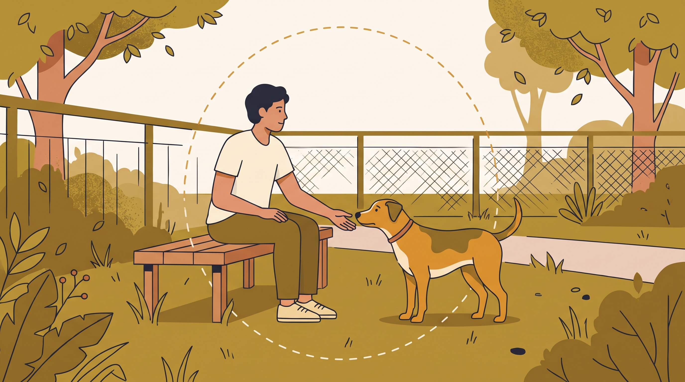

# **04\. Η Πρώτη Συνάντηση με τον υποψήφιο σκύλο: Τι να παρατηρήσετε στη συμπεριφορά του**

**Κατηγορία:** 14 - Πριν την Υιοθεσία (Επιλογή Σκύλου & Προετοιμασία)  
**Προτεινόμενο URL:** /blog/proti-synantisi-me-skylo-pros-yiothesia  
**Χρόνος ανάγνωσης:** 2 λεπτά

**Με μια ματιά (TL;DR)**

> * Η πρώτη συνάντηση είναι γνωριμία, όχι εξέταση χαρακτήρα.
> * Δίνουμε χρόνο και αποφεύγουμε πιεστικούς χειρισμούς.
> * Μία καλή ή δύσκολη στιγμή δεν προβλέπει όλη τη συμβίωση.

## **Προετοιμάστε ένα ήρεμο ραντεβού**

Συμφωνήστε με τον φορέα κατάλληλο χώρο και αριθμό ανθρώπων. Μια μεγάλη οικογενειακή παρέα μπορεί να δυσκολέψει την παρατήρηση. Ακολουθήστε τις οδηγίες του ανθρώπου που γνωρίζει τον σκύλο.

Μην περιμένετε άμεση εκδήλωση δεσίματος. Ένας σκύλος μπορεί να εξερευνά, να χρειάζεται απόσταση ή να είναι υπερδιεγερμένος από το περιβάλλον.

## **Τι παρατηρούμε**

1. **Εθελοντική προσέγγιση:** Μπορεί να πλησιάσει και να απομακρυνθεί χωρίς πίεση;
2. **Ανάκαμψη μετά από ερέθισμα:** Επιστρέφει σε εξερεύνηση ή παραμένει έντονα ανήσυχος;
3. **Άνεση στην κίνηση:** Παρατηρήστε βάδισμα και χειρισμό λουριού χωρίς να δοκιμάζετε δύσκολες ασκήσεις.
4. **Ανταπόκριση σε ήρεμη συνύπαρξη:** Δεν χρειάζεται να παίξει ή να δεχτεί χάδια για να είναι χρήσιμη η συνάντηση.

## **Τι αποφεύγουμε**

Μην σκύβετε πάνω του, μην τον αγκαλιάζετε και μην παίρνετε αντικείμενα από το στόμα του. Τροφή προσφέρεται μόνο με άδεια και χωρίς να τον δελεάζει σε επαφή που φοβάται.

Αν υπάρχουν παιδιά ή άλλος σκύλος στο σπίτι, οργανώστε ξεχωριστή, καθοδηγούμενη διαδικασία γνωριμίας. Δεν τα φέρνουμε ξαφνικά ως δοκιμασία.

Ζητήστε δεύτερη συνάντηση και χρόνο σκέψης. Η επιλογή δεν χρειάζεται να βασιστεί στην πίεση μιας στιγμής ή στην ιδέα ότι σας «διάλεξε» επειδή πήδηξε πάνω σας.

**Διαβάστε επίσης:** [Σήματα άνεσης και δυσφορίας](/blog/simata-iremias-skylou-calming-signals).
