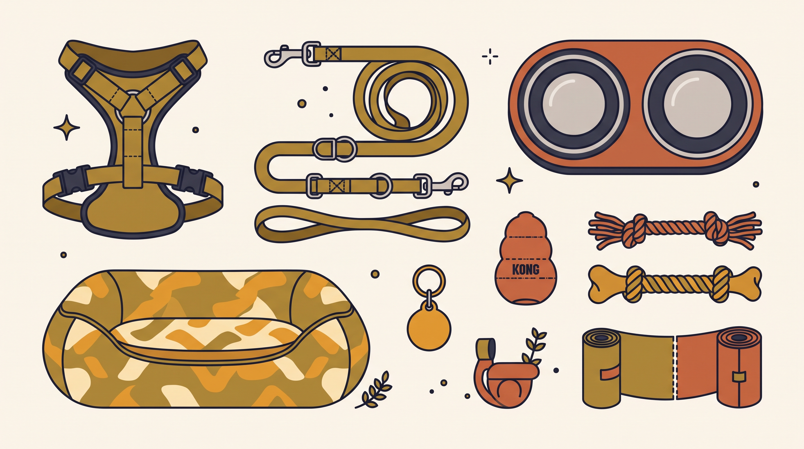

# **05\. Τι να αγοράσετε ΠΡΙΝ έρθει ο σκύλος στο σπίτι (και τι είναι πεταμένα λεφτά)**

**Κατηγορία:** 14 - Πριν την Υιοθεσία (Επιλογή Σκύλου & Προετοιμασία)  
**Προτεινόμενο URL:** /blog/lista-agoron-gia-neo-skylo-eksoplismos  
**Χρόνος ανάγνωσης:** 2 λεπτά

**Με μια ματιά (TL;DR)**

> * Ξεκινάμε με λίγα ασφαλή και κατάλληλα αντικείμενα.
> * Μέγεθος, εφαρμογή και προτιμήσεις έχουν μεγαλύτερη σημασία από μάρκα.
> * Τα πολλά παιχνίδια δεν αντικαθιστούν ήρεμη προσαρμογή.

## **Η βασική λίστα**

- **Εξοπλισμός βόλτας:** Κατάλληλο σαμαράκι, σταθερό λουρί και ταυτότητα. Για κίνδυνο απόδρασης ζητήστε ειδική εφαρμογή και σχέδιο ασφάλειας.
- **Νερό και τροφή:** Σταθερά μπολ και αρχικά η γνώριμη διατροφή, με αλλαγές κατόπιν συνεννόησης.
- **Ανάπαυση:** Άνετο κρεβάτι ή ασφαλής επιφάνεια σε ήσυχο σημείο.
- **Διαχείριση χώρου:** Κατάλληλα εμπόδια ή πόρτες, όχι υποχρεωτικά crate.
- **Καθαριότητα:** Σακούλες, πετσέτες και ασφαλές καθαριστικό.
- **Απασχόληση:** Λίγα παιχνίδια σωστού μεγέθους, χωρίς εύκολα αποσπώμενα κομμάτια.

## **Πριν αγοράσετε περισσότερα**

1. **Ζητήστε μετρήσεις και συνήθειες:** Ο φορέας μπορεί να γνωρίζει ποιος εξοπλισμός ήδη ταιριάζει.
2. **Ελέγξτε αντοχή και κουμπώματα:** Μην βασίζεστε μόνο στην ένδειξη κιλών.
3. **Δοκιμάστε με επίβλεψη:** Κανένα παιχνίδι δεν είναι άφθαρτο για κάθε σκύλο.
4. **Κρατήστε χρήματα για φροντίδα:** Κτηνιατρική αξιολόγηση και υποστήριξη μπορεί να είναι σημαντικότερες από ακριβές συσκευές.

## **Τι δεν χρειάζεται ως αρχική αγορά**

Πνίχτες, ηλεκτρικά κολάρα και συσκευές αυτόματης τιμωρίας δεν είναι απαραίτητα εργαλεία. Αποφύγετε επίσης σκληρά μασήματα χωρίς έλεγχο καταλληλότητας και εξοπλισμό μεταφοράς που δεν στερεώνεται σωστά.

Ένα crate μπορεί να είναι χρήσιμο μόνο με κατάλληλη εξοικείωση. Δεν είναι έτοιμη λύση για να μείνει άγνωστος σκύλος μόνος την πρώτη ημέρα.

**Διαβάστε επίσης:** [Εφαρμογή σαμαριού τύπου Υ](/blog/odigos-epilogis-samaraki-typou-y).
