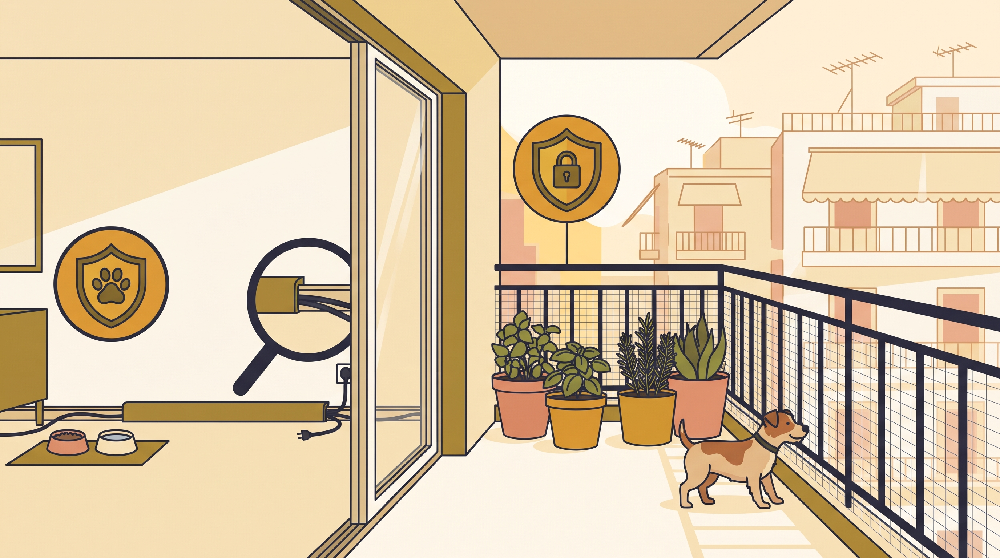

# **06\. Dog-proofing στο διαμέρισμα: Ασφαλέστερο σπίτι και μπαλκόνι**

**Κατηγορία:** 14 - Πριν την Υιοθεσία (Επιλογή Σκύλου & Προετοιμασία)  
**Προτεινόμενο URL:** /blog/dog-proofing-diamerisma-asfaleia-mpalkoni  
**Χρόνος ανάγνωσης:** 2 λεπτά

**Με μια ματιά (TL;DR)**

> * Ελέγχουμε το σπίτι πριν φτάσει ο σκύλος.
> * Το μπαλκόνι δεν γίνεται ασφαλές μόνο με πρόχειρο δίχτυ.
> * Κανένα μέτρο δεν αντικαθιστά την επίβλεψη και τη συντήρηση.

## **Δείτε τον χώρο από χαμηλά**

Καλώδια, σκουπίδια, φάρμακα και μικρά αντικείμενα μπορεί να είναι εύκολα προσβάσιμα. Οι έξοδοι είναι ιδιαίτερα σημαντικές για νέο σκύλο που μπορεί να πανικοβληθεί ή να ακολουθήσει κάποιον στην πόρτα.

Προετοιμάστε μια ήσυχη ζώνη με νερό και κρεβάτι, χωρίς να απομονώνετε τον σκύλο από κάθε ανθρώπινη παρουσία.

## **Έλεγχος σε τέσσερις περιοχές**

1. **Κουζίνα και μπάνιο:** Κλειστά ντουλάπια για καθαριστικά, φάρμακα και τρόφιμα. Προστατέψτε κάδους και πλυντήρια.
2. **Δωμάτια:** Ασφαλίστε καλώδια, μπαταρίες, κορδόνια και εύθραυστα αντικείμενα. Ελέγξτε φυτά για τοξικότητα με αξιόπιστη καθοδήγηση.
3. **Εξώπορτα και παράθυρα:** Προβλέψτε ασφαλή διαδικασία ανοίγματος και δεύτερο εμπόδιο όπου χρειάζεται. Σίτες εντόμων δεν είναι προστασία πτώσης.
4. **Μπαλκόνι:** Ελέγξτε κενά, ύψος, σημεία αναρρίχησης και αντοχή κατασκευής. Ζητήστε κατάλληλη επαγγελματική λύση όταν υπάρχει αμφιβολία.

## **Στην καθημερινότητα**

Μην αφήνετε τον σκύλο μόνο στο μπαλκόνι και μην τον δένετε κοντά σε κάγκελα. Μετακινήστε έπιπλα που λειτουργούν ως σκαλοπάτια. Ζέστη και θόρυβος παραμένουν προβλήματα ακόμη και με καλή περίφραξη.

Επανελέγχετε τον χώρο καθώς γνωρίζετε τις συνήθειές του. Αν καταπίνει ύφασμα ή ανοίγει πόρτες, η διαχείριση πρέπει να αλλάξει. Σε πιθανή κατάποση τοξικής ουσίας ζητήστε άμεσα κτηνιατρικές οδηγίες, χωρίς αυτοσχέδιες θεραπείες.

**Διαβάστε επίσης:** [Πρώτες 48 ώρες στο σπίτι](/blog/protes-48-ores-neou-skylou-sto-spiti).
