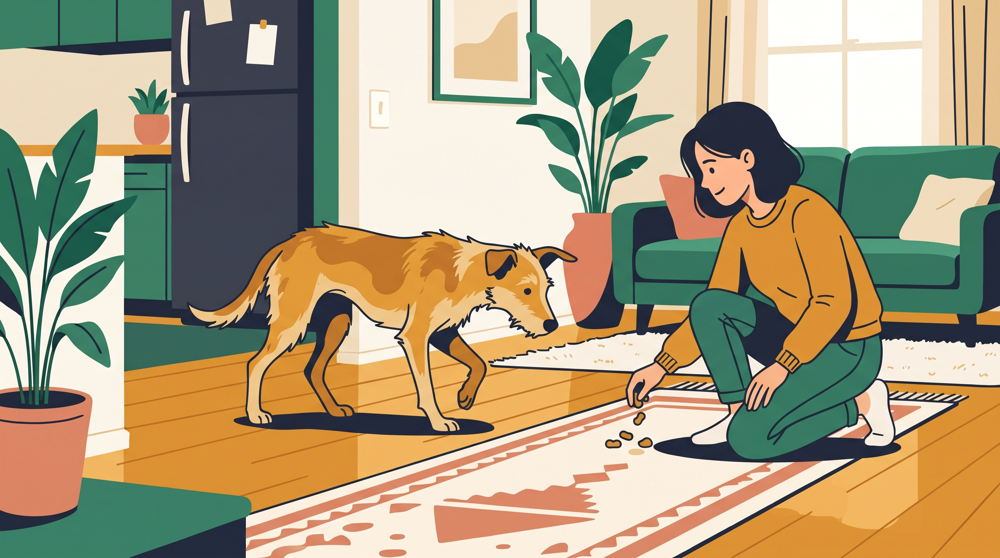

# **03\. Από τον δρόμο ή το καταφύγιο στα Εξάρχεια: Το «Πολιτισμικό Σοκ» της πόλης για έναν πρώην αδέσποτο σκύλο**

**Κατηγορία:** 15 - Η Μετάβαση μετά την Υιοθεσία (Αποσυμπίεση & Δέσιμο)  
**Προτεινόμενο URL:** /blog/adespotos-skylos-prosarmogi-stin-poli  
**Χρόνος ανάγνωσης:** 2 λεπτά

**Με μια ματιά (TL;DR)**

> * Η εμπειρία στον δρόμο δεν σημαίνει άνεση με κάθε αστικό περιβάλλον.
> * Ασανσέρ, οικιακές συσκευές και γλιστερά πατώματα μαθαίνονται σταδιακά.
> * Ασφαλής εξοπλισμός και μικρές διαδρομές προηγούνται της εξερεύνησης.

## **Ένα νέο σύνολο δυσκολιών**

Σκύλος από ήσυχη περιοχή μπορεί να δυσκολεύεται στο κέντρο της Αθήνας. Άλλος που γνώριζε δρόμους μπορεί να φοβάται το κλειστό διαμέρισμα. Δεν συμπεραίνουμε εμπειρίες μόνο από την ταμπέλα «αδέσποτος».

Παρατηρήστε ξεχωριστά κάθε δυσκολία. Η ηλεκτρική σκούπα, η είσοδος πολυκατοικίας και μια διασταύρωση δεν χρειάζεται να αντιμετωπιστούν την ίδια ημέρα.

## **Χτίστε έναν μικρό ασφαλή κόσμο**

1. **Ελέγξτε διαφυγές:** Εξώπορτα, μπαλκόνι και εφαρμογή σαμαριού χρειάζονται ιδιαίτερη προσοχή.
2. **Βελτιώστε το πάτημα:** Αντιολισθητικές διαδρομές προς νερό, κρεβάτι και έξοδο.
3. **Παρουσιάστε ήχους σταδιακά:** Συσκευή από απόσταση και χαμηλή ένταση όπου γίνεται, με δυνατότητα απομάκρυνσης.
4. **Κρατήστε γνώριμη βόλτα:** Ήσυχες ώρες και μικρή διαδρομή, χωρίς υποχρεωτική επαφή με ανθρώπους ή σκύλους.

## **Δεν πιέζουμε το πάγωμα**

Αν σταματήσει, μειώστε τις απαιτήσεις και αναζητήστε ασφαλή επιστροφή. Μην τραβάτε για να «καταλάβει ότι δεν υπάρχει κίνδυνος».

Αν δεν μπορεί να βγει για ανάγκες, πανικοβάλλεται ή δεν ξεκουράζεται, ζητήστε κτηνιατρική και συμπεριφορική βοήθεια. Χρειάζεται πρακτικό πλάνο καθημερινής φροντίδας, όχι μόνο υπομονή.

Η επιτυχία μπορεί αρχικά να είναι λίγα άνετα βήματα στην είσοδο. Δεν χρειάζεται να εξερευνήσει όλη τη γειτονιά για να θεωρηθεί καλή η βόλτα.

**Διαβάστε επίσης:** [Φόβος για ασανσέρ και σκάλες](/blog/skylos-fovatai-to-asanser-skales).
