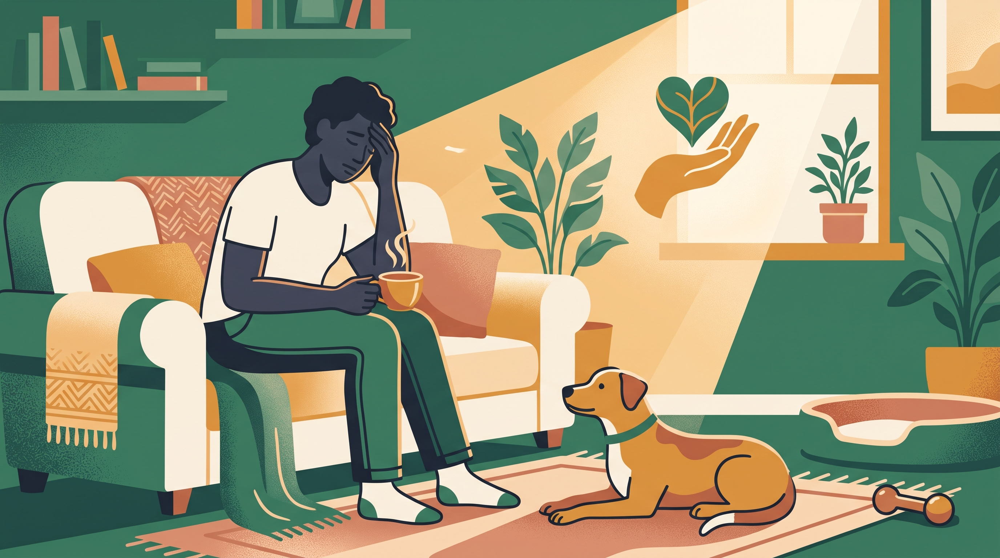

# **04\. Το «Σύνδρομο Μετά την Υιοθεσία» (Adoption Blues): Όταν αντί για χαρά νιώθετε άγχος, εξάντληση και τύψεις**

**Κατηγορία:** 15 - Η Μετάβαση μετά την Υιοθεσία (Αποσυμπίεση & Δέσιμο)  
**Προτεινόμενο URL:** /blog/adoption-blues-agxos-meta-tin-yiothesia-skylou  
**Χρόνος ανάγνωσης:** 2 λεπτά

**Με μια ματιά (TL;DR)**

> * Χαρά και δυσκολία μπορούν να συνυπάρχουν μετά την υιοθεσία.
> * Το «adoption blues» είναι περιγραφικός όρος, όχι διάγνωση.
> * Χρειάζεται υποστήριξη τόσο ο άνθρωπος όσο και ο σκύλος.

## **Όταν η καθημερινότητα διαφέρει από την προσδοκία**

Λιγότερος ύπνος, ανησυχία για τη δουλειά και συνεχής παρακολούθηση του νέου σκύλου μπορεί να φέρουν αμφιβολίες. Αυτά τα συναισθήματα δεν αποδεικνύουν ότι δεν τον αγαπάτε ή ότι είστε ακατάλληλος κηδεμόνας.

Δεν υπάρχει υποχρεωτική περίοδος κατά την οποία πρέπει να «νιώσετε δεμένοι». Η σχέση αναπτύσσεται μέσα από μικρές επαναλαμβανόμενες εμπειρίες.

## **Κάντε το επόμενο βήμα μικρότερο**

1. **Ορίστε βασικές προτεραιότητες:** Ασφάλεια, τροφή, τουαλέτα και ανάπαυση. Οι πολλές νέες δεξιότητες μπορούν να περιμένουν.
2. **Μοιράστε συγκεκριμένες δουλειές:** Ζητήστε βοήθεια για μία βόλτα ή λίγη παρουσία, όχι αόριστα «περισσότερη στήριξη».
3. **Επικοινωνήστε με τον φορέα:** Περιγράψτε τι δυσκολεύει και ζητήστε πληροφορίες ή καθοδήγηση.
4. **Πάρτε επαγγελματική βοήθεια νωρίς:** Κτηνίατρος για υγεία και κατάλληλος εκπαιδευτής για πρακτική οργάνωση.

## **Δώστε χώρο και στη δική σας υγεία**

Αν το άγχος είναι έντονο, παρατείνεται ή επηρεάζει σημαντικά ύπνο και λειτουργικότητα, μιλήστε με επαγγελματία ψυχικής υγείας. Ένα άρθρο για σκύλους δεν αντικαθιστά προσωπική φροντίδα.

Αν η συμβίωση δεν είναι ασφαλής, συζητήστε υπεύθυνες επιλογές με τον φορέα και επαγγελματίες. Δεν χρειάζεται να κρατάτε μυστικές σοβαρές δυσκολίες από ντροπή. Προτεραιότητα είναι ένα βιώσιμο, ασφαλές πλάνο για όλους.

**Διαβάστε επίσης:** [Κόπωση κηδεμόνα](/blog/koposi-kidemona-dyskolo-skylo-burnout).
