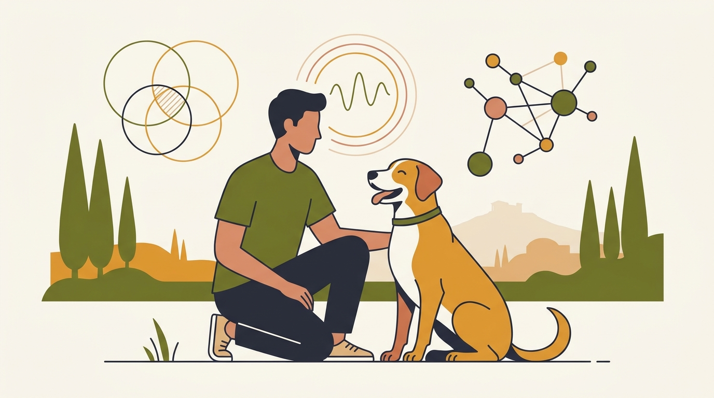

# **Πυλώνας 01: Επιστήμη, Θετική Εκπαίδευση & Κατάρριψη Μύθων**

**Προτεινόμενο URL:** /blog/enotita/epistimi-thetiki-ekpaidefsi-katarripsi-mython
**Χρώμα:** #6B7C3A
**Εισαγωγή:** Τι σημαίνει εκπαίδευση με επιβράβευση και πώς συνδυάζεται με σαφή όρια; Εξετάζουμε συνηθισμένους μύθους, εξηγούμε τις αρχές της μάθησης και δίνουμε κριτήρια επιλογής επαγγελματία που σέβεται την ευημερία του σκύλου.  
**Συνδεδεμένη Σελίδα:** /o-alexandros

## **Πίνακας Περιεχομένων (Άρθρα & Οδηγοί)**

> * **1\. Τι είναι η Θετική Εκπαίδευση Σκύλων (και γιατί ΔΕΝ σημαίνει «αφήνω τον σκύλο ασύδοτο»)**  
>   *URL:* /blog/ti-einai-i-thetiki-ekpaidefsi-skylon  
>   *Περιγραφή:* Πώς μπαίνουν τα όρια χωρίς βία, φωνές ή εκφοβισμό, μέσω της διαχείρισης περιβάλλοντος και της ενίσχυσης της επιθυμητής συμπεριφοράς.  
> * **2\. Ο μύθος του «Κυρίαρχου Σκύλου»: Γιατί δεν χρειάζεται να γίνετε αρχηγός της αγέλης**  
>   *URL:* /blog/mythos-kyriarxou-skylou-alpha-dog  
>   *Περιγραφή:* Τι σημαίνει κυριαρχία στην ηθολογία και γιατί δεν αποτελεί γενική εξήγηση της σχέσης ανθρώπου και σκύλου.  
> * **3\. «Θα δίνω λιχουδιές για πάντα;» Πώς λειτουργεί η επιβράβευση στην εκπαίδευση σκύλων**  
>   *URL:* /blog/lixoudies-stin-ekpaidefsi-skylon  
>   *Περιγραφή:* Η διαφορά μεταξύ δελεασμού και ενίσχυσης, ο σωστός χρονισμός και η σταδιακή αξιοποίηση επιβραβεύσεων της καθημερινής ζωής.  
> * **4\. Γιατί αποφεύγουμε πνίχτες, αγκαθωτά και ηλεκτρικά κολάρα στην εκπαίδευση**  
>   *URL:* /blog/giati-apofevgoume-pnixtes-ilektrika-kolara  
>   *Περιγραφή:* Οι κίνδυνοι πόνου, φόβου και καταστολής προειδοποιήσεων και οι εναλλακτικές που βασίζονται στην επιβράβευση.  
> * **5\. Γιατί δεν πρέπει ΠΟΤΕ να μαλώνετε έναν σκύλο όταν γρυλίζει**  
>   *URL:* /blog/giati-den-malonoume-skylo-pou-grylizei  
>   *Περιγραφή:* Το γρύλισμα ως πολύτιμο σύστημα συναγερμού: γιατί αν τιμωρήσουμε την προειδοποίηση, αφαιρούμε τις «μπαταρίες από τον ανιχνευτή καπνού».  
> * **6\. Πώς να επιλέξετε εκπαιδευτή σκύλων στην Αθήνα: 5 Red Flags που πρέπει να προσέξετε**  
>   *URL:* /blog/pos-na-epileksete-ekpaidefti-skylon  
>   *Περιγραφή:* Ερωτήσεις για μεθόδους, διαφάνεια και συνεργασία με τον κηδεμόνα, χωρίς υποσχέσεις εγγυημένων αποτελεσμάτων.
