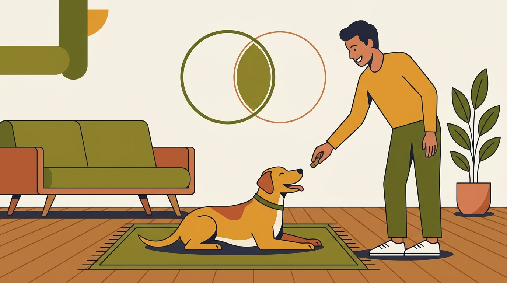

# **01\. Τι είναι η Θετική Εκπαίδευση Σκύλων (και γιατί ΔΕΝ σημαίνει «αφήνω τον σκύλο ασύδοτο»)**

**Κατηγορία:** 01 - Επιστήμη, Θετική Εκπαίδευση & Κατάρριψη Μύθων  
**Προτεινόμενο URL:** /blog/ti-einai-i-thetiki-ekpaidefsi-skylon  
**Χρόνος ανάγνωσης:** 2 λεπτά

**Με μια ματιά (TL;DR)**

> * Διδάσκουμε τι θέλουμε να κάνει ο σκύλος.
> * Τα όρια μπαίνουν με διαχείριση και εξάσκηση, όχι με πόνο.
> * Η ασφάλεια προηγείται της ευκαιρίας για μάθηση.

## **Επιβράβευση δεν σημαίνει ασυδοσία**

Αν ο σκύλος κλέβει φαγητό από τον πάγκο, απομακρύνουμε το φαγητό, περιορίζουμε προσωρινά την πρόσβαση και διδάσκουμε μια χρήσιμη εναλλακτική. Έτσι μειώνονται οι ευκαιρίες να εξασκεί τη συνήθεια και αυξάνονται οι ευκαιρίες επιτυχίας.

Στη μάθηση, ενίσχυση είναι μια συνέπεια που αυξάνει την πιθανότητα επανάληψης της συμπεριφοράς. Δεν είναι απαραίτητα λιχουδιά: μπορεί να είναι πρόσβαση σε μυρωδιά, παιχνίδι ή επαφή που ο σκύλος επιθυμεί.

## **Ένα πρακτικό παράδειγμα στην πόρτα**

1. **Προλάβετε την έξοδο:** Χρησιμοποιήστε εσωτερική πόρτα ή κατάλληλο εμπόδιο. Δεν βασιζόμαστε σε άσκηση που δεν έχει ακόμη μαθευτεί.
2. **Επιλέξτε εύκολο στόχο:** Επιβραβεύστε όταν στέκεται σε χαλάκι μακριά από την εξώπορτα.
3. **Προσθέστε μικρή δυσκολία:** Αγγίξτε το πόμολο, επιβραβεύστε και σταματήστε. Το άνοιγμα έρχεται αργότερα, με πρόσθετη ασφάλεια.
4. **Προσαρμόστε τις απαιτήσεις:** Αν σηκώνεται συνεχώς, μειώστε διάρκεια ή κίνηση αντί να δυναμώσετε τη φωνή.

## **Όταν υπάρχει σοβαρό πρόβλημα**

Φόβος, φύλαξη πόρων και επιθετική συμπεριφορά χρειάζονται αξιολόγηση, όχι μόνο περισσότερες λιχουδιές. Ένα πλάνο μπορεί να περιλαμβάνει κτηνιατρική φροντίδα, περιβαλλοντικές αλλαγές και σταδιακή τροποποίηση συμπεριφοράς.

Η εκπαίδευση με επιβράβευση δεν υπόσχεται ακαριαίο αποτέλεσμα. Επιδιώκει χρήσιμες δεξιότητες με όσο γίνεται μικρότερο κόστος για την ευημερία.

**Πηγή:** [AVSAB, Humane Dog Training](https://avsab.org/wp-content/uploads/2021/08/AVSAB-Humane-Dog-Training-Position-Statement-2021.pdf).

**Διαβάστε επίσης:** [Επιλογή εκπαιδευτή](/blog/pos-na-epileksete-ekpaidefti-skylon).
