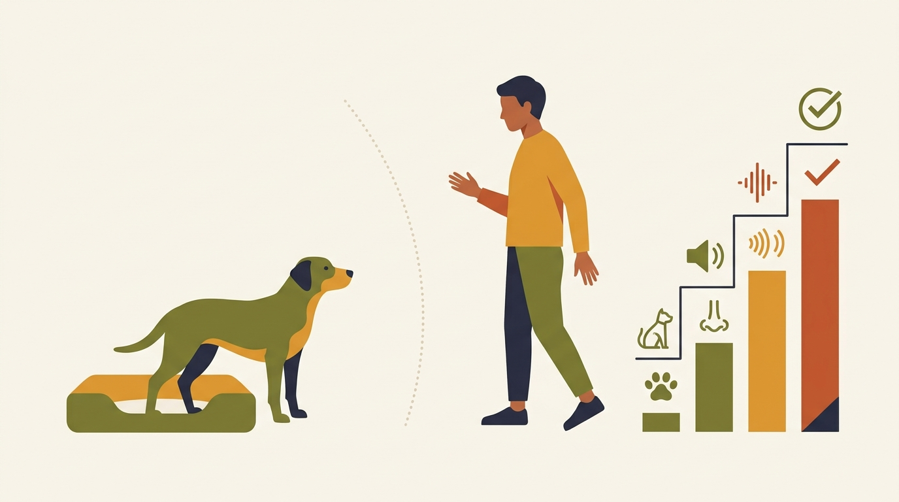

# **05\. Γιατί δεν πρέπει ΠΟΤΕ να μαλώνετε έναν σκύλο όταν γρυλίζει**

**Κατηγορία:** 01 - Επιστήμη, Θετική Εκπαίδευση & Κατάρριψη Μύθων  
**Προτεινόμενο URL:** /blog/giati-den-malonoume-skylo-pou-grylizei  
**Χρόνος ανάγνωσης:** 2 λεπτά

**Με μια ματιά (TL;DR)**

> * Το γρύλισμα είναι πληροφορία, όχι πρόσκληση για αντιπαράθεση.
> * Σταματάμε αυτό που προκαλεί δυσφορία και δημιουργούμε χώρο.
> * Το πλαίσιο ξεχωρίζει παιχνίδι, φόβο, πόνο και φύλαξη πόρων.

## **Ακούστε πριν προσπαθήσετε να διορθώσετε**

Ένα γρύλισμα κατά τη διελκυστίνδα δεν έχει αναγκαστικά την ίδια σημασία με ένα γρύλισμα όταν πλησιάζετε το μπολ. Κοιτάξτε ολόκληρο το σώμα, τι προηγήθηκε και αν ο σκύλος μπορεί να απομακρυνθεί.

Η τιμωρία μπορεί να περιορίσει την προειδοποίηση χωρίς να μειώσει την ανάγκη άμυνας. Δεν σημαίνει ότι κάθε σκύλος θα δαγκώσει αμέσως μετά, αλλά δυσκολεύει την έγκαιρη αναγνώριση κινδύνου.

## **Τι κάνουμε εκείνη τη στιγμή**

1. **Σταματήστε την προσέγγιση:** Μην απλώσετε χέρι, μην σκύψετε από πάνω του και μην τον κοιτάξετε επίμονα.
2. **Αυξήστε απόσταση ήρεμα:** Αφήστε διαδρομή διαφυγής. Απομακρύνετε παιδιά και ζώα χωρίς να τα στείλετε να «συμφιλιωθούν».
3. **Ασφαλίστε το περιβάλλον:** Αν φυλάει κάτι, μην το αρπάξετε. Χρησιμοποιήστε πόρτες και εμπόδια όταν γίνεται με ασφάλεια.
4. **Καταγράψτε το πλαίσιο:** Ήταν στον ύπνο, στο φαγητό ή στο άγγιγμα; Μην επαναλάβετε τη σκηνή για βίντεο.

## **Η λύση έρχεται μετά το περιστατικό**

Νέο γρύλισμα κατά την επαφή ή τη μετακίνηση χρειάζεται κτηνιατρικό έλεγχο για πόνο. Επαναλαμβανόμενη φύλαξη ή απειλή δαγκώματος απαιτεί αξιολόγηση και πλάνο ασφαλείας.

Δεν ζητάμε να ανέχεται τα πάντα. Διδάσκουμε δεξιότητες σε ήρεμες στιγμές και αλλάζουμε συνθήκες που τον πιέζουν. Αν κάποιος δαγκωθεί, προηγείται κατάλληλη ιατρική φροντίδα.

**Διαβάστε επίσης:** [Η κλίμακα της επιθετικότητας](/blog/klimaka-epithetikotitas-skylou-simadia).
