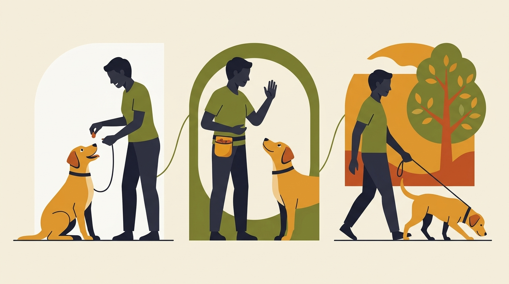

# **03\. «Θα δίνω λιχουδιές για πάντα;» Πώς λειτουργεί η επιβράβευση στην εκπαίδευση σκύλων**

**Κατηγορία:** 01 - Επιστήμη, Σύγχρονη Εκπαίδευση & Κατάρριψη Μύθων  
**Προτεινόμενο URL:** /blog/lixoudies-stin-ekpaidefsi-skylon  
**Χρόνος ανάγνωσης:** 2 λεπτά

**Με μια ματιά (TL;DR)**

> * Η επιβράβευση δίνει λόγο να επαναληφθεί μια συμπεριφορά.
> * Δεν χρειάζεται να φαίνεται φαγητό πριν από κάθε αίτημα.
> * Μειώνουμε τη συχνότητα σταδιακά, όχι την αξία της συνεργασίας.

## **«Το κάνει μόνο όταν βλέπει το μπισκότο»**

Στην αρχή, ένα κομμάτι τροφής μπορεί να καθοδηγήσει μια κίνηση. Αν παραμένει πάντα μπροστά στη μύτη, ο σκύλος μαθαίνει ότι είναι μέρος του σήματος. Η λύση δεν είναι να σταματήσουν όλες οι ανταμοιβές, αλλά να ξεχωρίσουμε το αίτημα από την πληρωμή.

Η ίδια τροφή δεν έχει ίδια αξία παντού. Στο σαλόνι μπορεί να αρκεί μια κροκέτα, ενώ στο πεζοδρόμιο το περιβάλλον ανταγωνίζεται την προσοχή σας.

## **Πώς περνάμε σε καθαρό σήμα**

1. **Διδάξτε σε εύκολο χώρο:** Λίγες επαναλήψεις, σαφής κίνηση ή λέξη και άμεση ανταμοιβή.
2. **Κρύψτε τη λιχουδιά:** Κάντε το γνώριμο σήμα με άδειο χέρι. Μόλις ανταποκριθεί, σημειώστε την επιτυχία με μια λέξη και δώστε τροφή από την τσέπη.
3. **Αλλάξτε ένα πράγμα κάθε φορά:** Προσθέστε λίγη διάρκεια ή ήπιο περισπασμό. Σε νέο περιβάλλον επιστρέψτε σε συχνότερη ενίσχυση.
4. **Αξιοποιήστε την καθημερινότητα:** Μετά από χαλαρό περπάτημα επιτρέψτε μύρισμα σε ασφαλές σημείο, αν αυτό θέλει.

## **Πότε δεν μειώνουμε βιαστικά**

Η επαναφορά και άλλες κρίσιμες δεξιότητες αξίζουν σταθερά καλή επιβράβευση. Στη δουλειά με φόβο, η τροφή μπορεί να αλλάζει τη συναισθηματική σύνδεση, όχι να πληρώνει υπακοή.

Κρατήστε τις μπουκιές μικρές και υπολογίστε τις στη διατροφή. Μην αφήνετε τον σκύλο νηστικό για να «αποδώσει». Αν δεν τρώει, εξετάστε κορεσμό, στρες, προτίμηση ή υγεία.

**Διαβάστε επίσης:** [Επιλογή λιχουδιών](/blog/ierarxia-lixoudion-ekpaidefsi-skylou).
