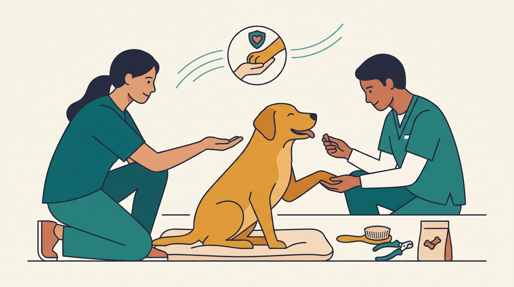

# **Πυλώνας 02: Συνεργατική Φροντίδα, Κτηνίατρος & Grooming (Cooperative Care)**

**Εισαγωγή:** Πολλά σκυλιά βιώνουν έντονο τρόμο στον κτηνίατρο, στο μπάνιο ή στο κόψιμο των νυχιών. Αυτός ο πυλώνας παρουσιάζει τη «Συνεργατική Φροντίδα», δίνοντας στον σκύλο αίσθηση ελέγχου και συναίνεσης ώστε οι διαδικασίες υγείας να γίνονται χωρίς πάλη.  
**Συνδεδεμένη Υπηρεσία:** /ypiresies/antimetopisi-provlimaton-symperiforas & /ypiresies/astiki-symviosi-ypakoi

## **Πίνακας Περιεχομένων (Άρθρα & Οδηγοί)**

> * **1\. Ο σκύλος φοβάται τον κτηνίατρο: Πώς βοηθά η συνεργατική φροντίδα**  
>   *URL:* /blog/skylos-fovatai-ton-ktiniatro  
>   *Περιγραφή:* Σταδιακή εξοικείωση, επισκέψεις γνωριμίας και κοινό πλάνο με την κτηνιατρική ομάδα, χωρίς καθυστέρηση αναγκαίας περίθαλψης.  
> * **2\. Κόψιμο νυχιών χωρίς δράματα: Πώς να μάθετε στον σκύλο σας να σας δίνει το πόδι του εθελοντικά**  
>   *URL:* /blog/kopsimo-nyxion-skylou-xoris-fovo  
>   *Περιγραφή:* Απευαισθητοποίηση στον νυχοκόπτη, χρήση λίμας (scratchpad) και το σήμα «ξεκινάμε/σταματάμε» που δίνει ασφάλεια στον σκύλο.  
> * **3\. Εκπαίδευση φίμωτρου με θετικό τρόπο: Ένα χρήσιμο εργαλείο ασφάλειας**  
>   *URL:* /blog/ekpaidefsi-fimotrou-thetiki-methodos  
>   *Περιγραφή:* Επιλογή άνετου φίμωτρου τύπου καλαθιού και σταδιακή εξοικείωση. Το φίμωτρο δεν αντικαθιστά την απόσταση ή τους κανόνες μεταφοράς.  
> * **4\. Μπάνιο, βούρτσισμα και στέγνωμα στο σπίτι με λιγότερο στρες**  
>   *URL:* /blog/mpanio-skylou-sto-spiti-xoris-stres  
>   *Περιγραφή:* Αντιολισθητικό πάτημα, ήπια περιποίηση και μικρά βήματα εξοικείωσης, με παύσεις όταν ο σκύλος δυσκολεύεται.  
> * **5\. Πώς να βάζετε σταγόνες στα αυτιά/μάτια και να δίνετε χάπι στον σκύλο σας χωρίς πάλη**  
>   *URL:* /blog/pos-na-doso-xapi-stagones-se-skylo  
>   *Περιγραφή:* Η τεχνική του Chin Rest (ακούμπισμα μουσούδας) και έξυπνα κόλπα χορήγησης φαρμάκων χωρίς να κλονιστεί η εμπιστοσύνη του σκύλου.  
> * **6\. Ο σκύλος δεν με αφήνει να του βάλω το σαμαράκι ή να του σκουπίσω τα πόδια μετά τη βόλτα**  
>   *URL:* /blog/skylos-antidra-sto-samaraki-podia  
>   *Περιγραφή:* Γιατί πολλά σκυλιά αντιδρούν όταν σκύβουμε πάνω τους στην εξώπορτα και πώς μετατρέπουμε τη ρουτίνα εισόδου/εξόδου σε συνεργασία.
