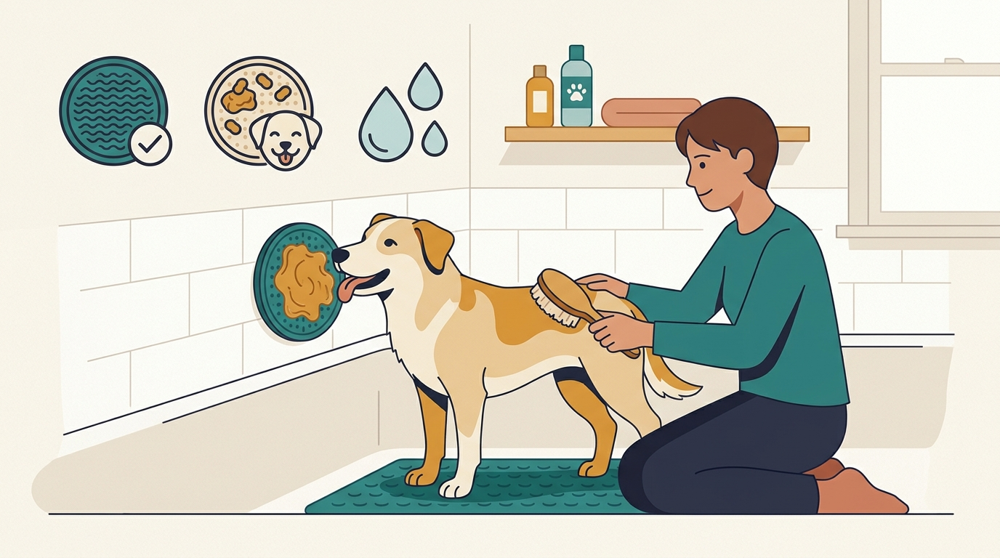

# **04\. Μπάνιο, βούρτσισμα και στέγνωμα στο σπίτι με λιγότερο στρες**

**Κατηγορία:** 02 - Συνεργατική Φροντίδα, Κτηνίατρος & Grooming  
**Προτεινόμενο URL:** /blog/mpanio-skylou-sto-spiti-xoris-stres  
**Χρόνος ανάγνωσης:** 2 λεπτά

**Με μια ματιά (TL;DR)**

> * Χωρίζουμε μπάνιο, βούρτσισμα και στέγνωμα σε διαφορετικές δεξιότητες.
> * Προσφέρουμε σταθερό πάτημα και μικρή διάρκεια.
> * Κόμποι, δερματικές βλάβες ή πόνος δεν λύνονται με επιμονή.

## **Γιατί η μπανιέρα προκαλεί αντίδραση**

Το γλίστρημα, ο περιορισμός και ο ήχος του νερού μπορεί να είναι δυσάρεστα. Ένας σκύλος που απομακρύνεται από τη βούρτσα μπορεί επίσης να πονά από κόμπους ή ερεθισμένο δέρμα. Δεν τον χαρακτηρίζουμε «δύσκολο» πριν ελέγξουμε αυτά τα ενδεχόμενα.

Προετοιμάστε πετσέτες και κατάλληλα προϊόντα εκ των προτέρων. Η συχνότητα μπάνιου εξαρτάται από τρίχωμα, τρόπο ζωής και τυχόν κτηνιατρική αγωγή.

## **Μικρά βήματα φροντίδας**

1. **Εξοικείωση χωρίς νερό:** Αφήστε τον να πλησιάσει ασφαλή, αντιολισθητικό χώρο. Μην τον σηκώνετε και τον εγκλωβίζετε αν αντιδρά.
2. **Ελάχιστο βούρτσισμα:** Μία απαλή κίνηση σε άνετο σημείο, ανταμοιβή και παύση. Δεν τραβάμε κόμπους.
3. **Νερό με χαμηλή πίεση:** Ξεκινήστε μακριά από το πρόσωπο, σε κατάλληλη θερμοκρασία. Αποφύγετε νερό στα αυτιά και ερεθιστικά προϊόντα στα μάτια.
4. **Στέγνωμα χωρίς υπερθέρμανση:** Προτιμήστε ήπιο ταμπονάρισμα. Πιστολάκι μόνο αν το ανέχεται, με ασφαλή θερμοκρασία και απόσταση, ποτέ κατευθείαν στο πρόσωπο.

## **Η απασχόληση δεν ακυρώνει τη δυσφορία**

Ένα χαλάκι γλειψίματος μπορεί να βοηθήσει, αλλά το ότι τρώει δεν σημαίνει ότι συναινεί σε κάθε χειρισμό. Αν παγώνει, στρίβει απότομα ή προσπαθεί να φύγει, σταματήστε και μειώστε τη δυσκολία.

Για έντονους κόμπους μη χρησιμοποιείτε ψαλίδι κοντά στο δέρμα. Ζητήστε ασφαλή επαγγελματική φροντίδα και κτηνιατρική εκτίμηση αν υπάρχει πόνος, πληγή ή επίμονος κνησμός.

**Διαβάστε επίσης:** [Το τεστ συναίνεσης στα χάδια](/blog/test-synainesis-sta-xadia-skylou).
