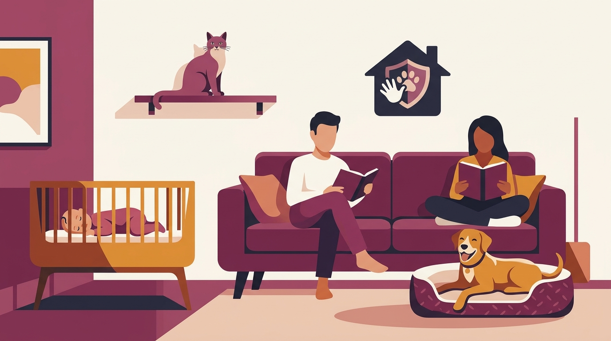

# **Πυλώνας 03: Οικογένεια, Μωρά, Παιδιά & Πολλά Κατοικίδια**

**Προτεινόμενο URL:** /blog/enotita/oikogeneia-mora-paidia-polla-katoikidia
**Χρώμα:** #9B4D6B
**Εισαγωγή:** Οι δυναμικές μέσα στο σπίτι αλλάζουν όταν προστίθεται ένα μωρό, μια γάτα, ένας δεύτερος σκύλος ή επισκέπτες. Αυτός ο πυλώνας προσφέρει πρακτικά πρωτόκολλα ασφάλειας και ομαλής συνύπαρξης για ολόκληρη την οικογένεια.  
**Συνδεδεμένη Υπηρεσία:** /ypiresies/astiki-symviosi-ypakoi & /ypiresies/antimetopisi-provlimaton-symperiforas

## **Πίνακας Περιεχομένων (Άρθρα & Οδηγοί)**

> * **1\. Ερχομός μωρού στο σπίτι: Πώς να προετοιμάσετε τον σκύλο σας τους 9 μήνες της εγκυμοσύνης**  
>   *URL:* /blog/proetoimasia-skylou-gia-neo-moro  
>   *Περιγραφή:* Σταδιακές αλλαγές στη ρουτίνα, εξοικείωση με ήχους μωρού, βόλτα δίπλα στο καρότσι και δημιουργία ζωνών ασφαλείας στο σπίτι.  
> * **2\. Σκύλος και Γάτα στο ίδιο διαμέρισμα: Οδηγός ασφαλούς γνωριμίας βήμα-βήμα**  
>   *URL:* /blog/symviosi-skylou-gatas-sto-spiti  
>   *Περιγραφή:* Ανταλλαγή οσμών, χρήση baby gates, υπερυψωμένα σημεία διαφυγής για τη γάτα και επιβράβευση της ήρεμης συνύπαρξης.  
> * **3\. Παιδιά και Σκύλος: Οι 5 χρυσοί κανόνες ασφαλείας που πρέπει να ξέρει κάθε γονιός**  
>   *URL:* /blog/paidia-kai-skylos-kanones-asfaleias  
>   *Περιγραφή:* Πώς μαθαίνουμε στα παιδιά να σέβονται τον χώρο και τον ύπνο του σκύλου, και γιατί η επίβλεψη πρέπει να είναι ενεργή.  
> * **4\. Δεύτερος σκύλος στο σπίτι: Πώς να κάνετε τη γνωριμία σωστά και να αποφύγετε τις εντάσεις**  
>   *URL:* /blog/defteros-skylos-sto-spiti-gnorimia  
>   *Περιγραφή:* Η πρώτη συνάντηση σε ουδέτερο έδαφος, η διαχείριση παιχνιδιών/τροφής τις πρώτες εβδομάδες και η σημασία του ξεχωριστού χρόνου.  
> * **5\. Ο σκύλος μου πηδάει πάνω στους καλεσμένους όταν μπαίνουν στο σπίτι: Πώς του μαθαίνουμε ήρεμο χαιρετισμό**  
>   *URL:* /blog/skylos-pidaei-stous-kalesmenous  
>   *Περιγραφή:* Γιατί ο ενθουσιασμός στην πόρτα κορυφώνεται και πώς διδάσκουμε εναλλακτική συμπεριφορά με τις τέσσερις πατούσες στο πάτωμα.  
> * **6\. Ζήλια στον σκύλο όταν αγκαλιάζω τον/την σύντροφό μου: Είναι όντως ζήλια ή κάτι άλλο;**  
>   *URL:* /blog/skylos-zilevei-otan-agkaliazomaste  
>   *Περιγραφή:* Πιθανές αιτίες όπως αναζήτηση προσοχής, διέγερση ή δυσφορία, χωρίς να αποδίδουμε βέβαια ανθρώπινα κίνητρα στον σκύλο.
