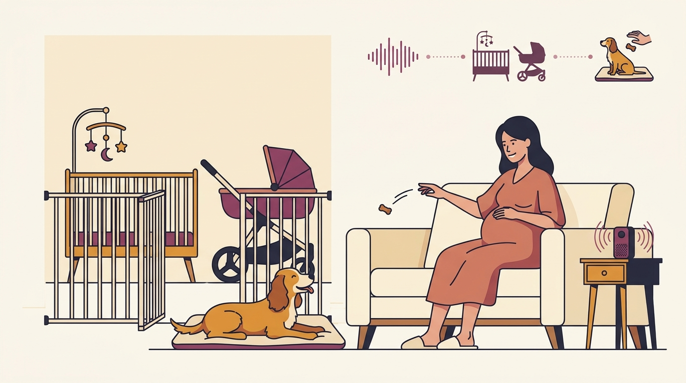

# **01\. Ερχομός μωρού στο σπίτι: Πώς να προετοιμάσετε τον σκύλο σας τους 9 μήνες της εγκυμοσύνης**

**Κατηγορία:** 03 - Οικογένεια, Μωρά, Παιδιά & Πολλά Κατοικίδια  
**Προτεινόμενο URL:** /blog/proetoimasia-skylou-gia-neo-moro  
**Χρόνος ανάγνωσης:** 2 λεπτά

**Με μια ματιά (TL;DR)**

> * Οι αλλαγές αρχίζουν πριν έρθει το μωρό και γίνονται σταδιακά.
> * Μωρό και σκύλος δεν μένουν ποτέ μαζί χωρίς ενεργή επίβλεψη.
> * Ο ασφαλής χωρισμός είναι καθημερινό εργαλείο, όχι τιμωρία.

## **Η προετοιμασία αφορά ολόκληρο το σπίτι**

Νέοι ήχοι, λιγότερος ύπνος και αλλαγές στις βόλτες επηρεάζουν τη ρουτίνα. Δεν χρειάζεται ο σκύλος να αγαπήσει κάθε αλλαγή αμέσως. Χρειάζεται προβλεψιμότητα, ήσυχο καταφύγιο και ενήλικες που μπορούν να καλύπτουν τις ανάγκες του.

Αν υπάρχει ιστορικό φύλαξης, φόβου παιδιών ή δαγκώματος, ζητήστε αξιολόγηση πριν τη γέννηση. Μην περιμένετε να δείτε «πώς θα πάει» στην πρώτη συνάντηση.

## **Τέσσερα βήματα πριν τον ερχομό**

1. **Οργανώστε ζώνες:** Σταθερά εμπόδια και κλειστές πόρτες επιτρέπουν ασφαλή χωρισμό. Εξοικειώστε τον σκύλο με αυτές τις αλλαγές νωρίς.
2. **Μοιράστε τη φροντίδα:** Ο άνθρωπος που θα αναλάβει περισσότερες βόλτες αρχίζει σταδιακά. Προβλέψτε βοήθεια για τις πρώτες εβδομάδες.
3. **Εξοικειώστε με εξοπλισμό:** Καρότσι και κρεβατάκι εμφανίζονται χωρίς πίεση. Ήχοι μωρού παίζουν μόνο χαμηλά, αν παραμένει άνετος.
4. **Διδάξτε ήρεμη παραμονή:** Επιβραβεύστε ξεκούραση σε χαλάκι και μετακίνηση σε άλλο χώρο όταν ζητείται.

## **Η πρώτη συνάντηση δεν είναι τεστ**

Δεν φέρνουμε το μωρό κοντά στη μουσούδα και δεν απαιτούμε μύρισμα. Ένας ενήλικας φροντίζει το μωρό και άλλος τον σκύλο, με ασφαλή απόσταση και δυνατότητα χωρισμού.

Στο τάισμα, την αλλαγή πάνας ή όταν ο ενήλικας αποκοιμιέται, η προσοχή δεν είναι διαθέσιμη για επίβλεψη: χρησιμοποιήστε χωριστούς χώρους. Η ασφάλεια χρειάζεται επανεκτίμηση όταν το παιδί αρχίσει να μπουσουλά.

**Διαβάστε επίσης:** [Παιδιά και σκύλος](/blog/paidia-kai-skylos-kanones-asfaleias).
