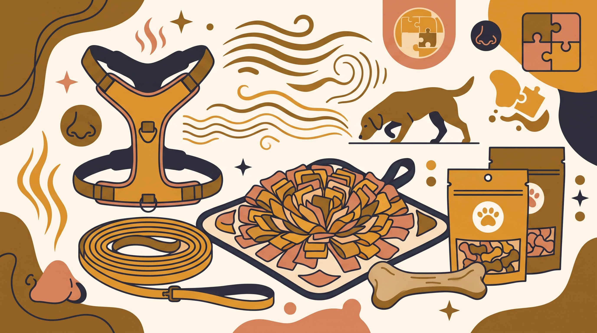

# **Πυλώνας 04: Εξοπλισμός, Λιχουδιές & Αισθητηριακός Πλούτος**

**Προτεινόμενο URL:** /blog/enotita/exoplismos-lixoudies-aisthitiriakos-ploutos
**Χρώμα:** #7A5C2E
**Εισαγωγή:** Ο σωστός εξοπλισμός και τα κατάλληλα μέσα απασχόλησης κάνουν την καθημερινότητα στην πόλη πιο ασφαλή και ευχάριστη. Αυτός ο πυλώνας αναλύει πρακτικά τα εργαλεία βόλτας, την ιεραρχία των επιβραβεύσεων και τη σημασία της φυσικής μάσησης για την εκτόνωση του στρες.  
**Συνδεδεμένη Υπηρεσία:** /ypiresies/astiki-symviosi-ypakoi

## **Πίνακας Περιεχομένων (Άρθρα & Οδηγοί)**

> * **1\. Οδηγός Επιλογής & Εφαρμογής για Σαμαράκι Τύπου Υ: Πώς να ελέγξετε αν ενοχλεί τους ώμους του σκύλου**  
>   *URL:* /blog/odigos-epilogis-samaraki-typou-y  
>   *Περιγραφή:* Πρακτικά κριτήρια εφαρμογής ώστε το σαμαράκι να επιτρέπει ελεύθερη κίνηση της ωμοπλάτης χωρίς τριβές στις μασχάλες.  
> * **2\. Long line: Πώς χρησιμοποιούμε μακρύ λουρί με ασφάλεια**  
>   *URL:* /blog/long-line-makry-louri-ekpaidefsi  
>   *Περιγραφή:* Διαχείριση μήκους, αποφυγή μπλεξίματος και εξάσκηση επαναφοράς σε κατάλληλους χώρους, χωρίς εγγύηση μηδενικού κινδύνου.  
> * **3\. Η ιεραρχία των λιχουδιών: Πώς βρίσκουμε τι αξίζει για τον δικό μας σκύλο**  
>   *URL:* /blog/ierarxia-lixoudion-ekpaidefsi-skylou  
>   *Περιγραφή:* Επιλογή μικρών, κατάλληλων επιβραβεύσεων ανάλογα με προτιμήσεις, υγεία και δυσκολία περιβάλλοντος.  
> * **4\. Μασήματα για σκύλους: Απασχόληση, επιλογή και ασφάλεια**  
>   *URL:* /blog/fysika-masimata-ektonosi-stres-skylou  
>   *Περιγραφή:* Γιατί το «φυσικό» δεν σημαίνει ακίνδυνο και πώς μειώνουμε κινδύνους για δόντια, πνιγμό και κατάποση.  
> * **5\. Snuffle Mats (Χαλάκια Όσφρησης) & Παζλ Φαγητού: Πώς να μετατρέψετε το γεύμα σε πνευματική εργασία**  
>   *URL:* /blog/snuffle-mat-pazl-fagitou-skylos  
>   *Περιγραφή:* Εύκολες αναζητήσεις τροφής και κατάλληλα παζλ, χωρίς να χρειάζεται ο σκύλος να δουλεύει για κάθε γεύμα.  
> * **6\. Λέιζερ, μπαλάκι και διελκυστίνδα: Πώς κρατάμε το παιχνίδι ισορροπημένο**  
>   *URL:* /blog/paixnidia-pou-anevazoun-entasi-laser-mpalaki  
>   *Περιγραφή:* Αποφυγή λέιζερ, πρόληψη επαναλαμβανόμενης καταπόνησης και παύσεις στο παιχνίδι χωρίς να θεωρούμε κάθε ενθουσιασμό πρόβλημα.
