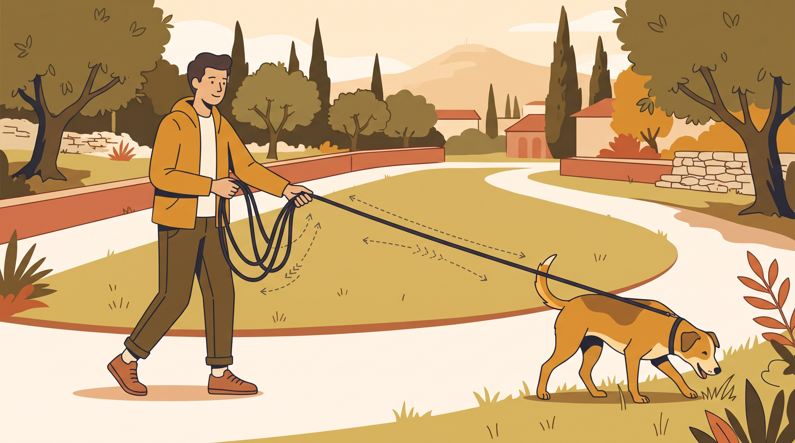

# **02\. Long line: Πώς χρησιμοποιούμε μακρύ λουρί με ασφάλεια**

**Κατηγορία:** 04 - Εξοπλισμός, Λιχουδιές & Αισθητηριακός Πλούτος  
**Προτεινόμενο URL:** /blog/long-line-makry-louri-ekpaidefsi  
**Χρόνος ανάγνωσης:** 2 λεπτά

**Με μια ματιά (TL;DR)**

> * Το long line προσφέρει περισσότερο χώρο, όχι ανεξέλεγκτη ελευθερία.
> * Χρησιμοποιείται σε κατάλληλους επιτρεπόμενους χώρους, μακριά από κυκλοφορία.
> * Σύνδεση σε κατάλληλο σαμαράκι, όχι στον λαιμό.

## **Το μήκος προσαρμόζεται στο περιβάλλον**

Ένα λουρί πέντε ή δέκα μέτρων μπορεί να βοηθήσει σε εξερεύνηση και επαναφορά. Σε στενό μονοπάτι, ποδηλατόδρομο ή γεμάτο πάρκο μπορεί αντίθετα να δημιουργήσει πτώση, μπλέξιμο ή απότομο τερματισμό.

Επιλέξτε κατάλληλο βάρος και ανθεκτικό υλικό. Το biothane καθαρίζεται εύκολα, αλλά μπορεί να γλιστρά όταν βραχεί. Κάθε υλικό χρειάζεται πρακτική εξάσκηση χειρισμού.

## **Πριν δώσετε περισσότερο μήκος**

1. **Ελέγξτε τον χώρο:** Ορατότητα, έξοδοι, ζώα, άνθρωποι και τοπικοί κανόνες.
2. **Κρατήστε χωρίς τύλιγμα:** Ποτέ γύρω από χέρι, δάχτυλα ή σώμα. Αποφύγετε χαλαρούς βρόχους στα πόδια.
3. **Προλάβετε την επιτάχυνση:** Μαζέψτε έγκαιρα περιττό μήκος ώστε να μη φτάσει τρέχοντας στο τέλος.
4. **Εξασκήστε επιστροφή:** Καλέστε σε εύκολη στιγμή, επιβραβεύστε και επιτρέψτε ξανά εξερεύνηση. Δεν τραβάμε τον σκύλο προς εμάς ως μάθημα.

## **Πότε δεν το χρησιμοποιούμε**

Όχι σε ανεξέλεγκτο ομαδικό παιχνίδι, κοντά σε δρόμο ή όταν δεν μπορείτε να διαχειριστείτε τη δύναμη του σκύλου. Μην πατάτε λουρί σκύλου που τρέχει για απότομο φρενάρισμα.

Προσέξτε εγκαύματα τριβής και μπλέξιμο γύρω από ζώα. Σε έντονη καταδίωξη ή κίνδυνο απόδρασης ζητήστε επαγγελματική καθοδήγηση πριν δώσετε μεγάλο μήκος.

**Διαβάστε επίσης:** [Επαναφορά με κυνηγόσκυλο](/blog/kynigoskyla-stin-poli-mpigkl-ekpaidefsi).
