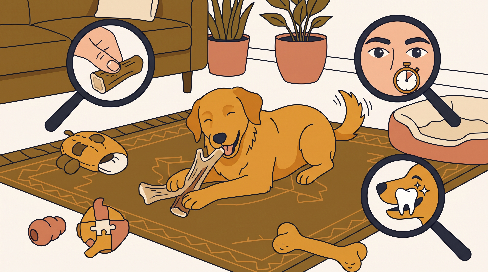

# **04\. Μασήματα για σκύλους: Απασχόληση, επιλογή και ασφάλεια**

**Κατηγορία:** 04 - Εξοπλισμός, Λιχουδιές & Αισθητηριακός Πλούτος  
**Προτεινόμενο URL:** /blog/fysika-masimata-ektonosi-stres-skylou  
**Χρόνος ανάγνωσης:** 2 λεπτά

**Με μια ματιά (TL;DR)**

> * Το «φυσικό» δεν σημαίνει ακίνδυνο.
> * Δόντια, μέγεθος και τρόπος μάσησης καθορίζουν την καταλληλότητα.
> * Κανένα μάσημα δεν προσφέρεται χωρίς αξιολόγηση και επίβλεψη.

## **Τι μπορεί να προσφέρει η μάσηση**

Για πολλούς σκύλους είναι ευχάριστη δραστηριότητα. Δεν υπάρχει όμως εγγύηση ότι συγκεκριμένα λεπτά μάσησης θα μειώσουν το στρες. Κάποιοι καταπίνουν γρήγορα, άλλοι φυλάνε το αντικείμενο και άλλοι δεν ενδιαφέρονται.

Πολύ σκληρά υλικά, όπως οστά, κέρατα ή οπλές, μπορούν να προκαλέσουν κατάγματα δοντιών. Η ασφάλεια δεν κρίνεται μόνο από το αν το προϊόν πωλείται για σκύλους.

## **Πριν προσφέρετε μάσημα**

1. **Συζητήστε καταλληλότητα:** Ιδιαίτερα για κουτάβι, ηλικιωμένο σκύλο, οδοντικό πρόβλημα ή ειδική δίαιτα.
2. **Επιλέξτε σωστό μέγεθος:** Να μην μπορεί να καταποθεί ολόκληρο. Ελέγξτε οδηγίες και πιθανότητα αποκόλλησης κομματιών.
3. **Προσφέρετε ήσυχο χωριστό χώρο:** Μακριά από παιδιά και άλλα ζώα, χωρίς να πλησιάζετε συνεχώς.
4. **Παρακολουθήστε τη χρήση:** Αφαιρέστε με ασφαλή, ήδη μαθημένη ανταλλαγή όταν μικρύνει επικίνδυνα ή φθαρεί.

## **Τι αποφεύγουμε**

Μην δίνετε μαγειρεμένα κόκαλα και μην υποθέτετε ότι ωμά οστά είναι ασφαλή. Υπάρχουν κίνδυνοι τραυματισμού, απόφραξης και παθογόνων. Υπολογίστε επίσης θερμίδες και πεπτική ανοχή.

Πνιγμός, εμετός, αίμα, πόνος ή πιθανή κατάποση μεγάλου κομματιού απαιτούν άμεση κτηνιατρική επικοινωνία. Σε φύλαξη πόρων μην προσπαθείτε να το αρπάξετε· χρειάζεται διαφορετικό πλάνο διαχείρισης.

**Διαβάστε επίσης:** [Φύλαξη πόρων](/blog/skylos-grylizei-sto-fagito-kanape).
