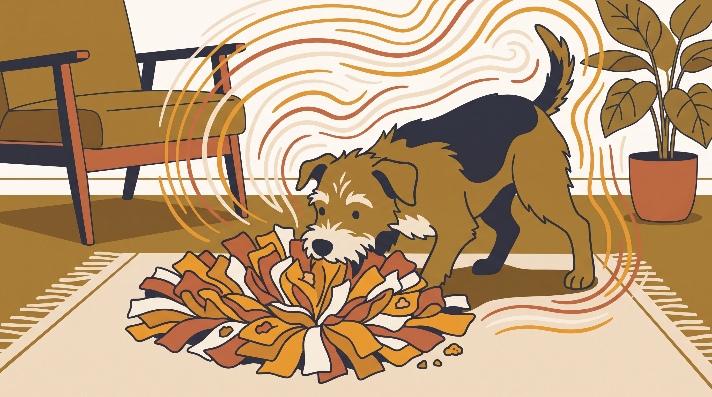

# **05\. Snuffle Mats (Χαλάκια Όσφρησης) & Παζλ Φαγητού: Πώς να μετατρέψετε το γεύμα σε πνευματική εργασία**

**Κατηγορία:** 04 - Εξοπλισμός, Λιχουδιές & Αισθητηριακός Πλούτος  
**Προτεινόμενο URL:** /blog/snuffle-mat-pazl-fagitou-skylos  
**Χρόνος ανάγνωσης:** 2 λεπτά

**Με μια ματιά (TL;DR)**

> * Τα παζλ είναι προαιρετικός εμπλουτισμός, όχι υποχρεωτική εργασία για κάθε γεύμα.
> * Ξεκινάμε εύκολα και προσαρμόζουμε τη δυσκολία.
> * Επίβλεψη και καθαριότητα παραμένουν απαραίτητες.

## **Επιτυχία δεν σημαίνει πολλή ώρα προσπάθειας**

Ένα παιχνίδι που κρατά τον σκύλο απασχολημένο αλλά τον κάνει να γαβγίζει, να δαγκώνει μανιωδώς ή να το εγκαταλείπει ίσως είναι πολύ δύσκολο. Στόχος είναι μια ευχάριστη αναζήτηση, όχι να εμποδίσουμε την πρόσβαση στην τροφή.

Κάποιοι σκύλοι προτιμούν μπολ. Αυτό δεν είναι έλλειψη ευφυΐας ή αποτυχία εμπλουτισμού.

## **Μια εύκολη πρώτη δοκιμή**

1. **Βάλτε λίγη γνώριμη τροφή εμφανώς:** Πάνω σε καθαρό χαλάκι ή σε πολύ απλές θήκες, χωρίς βαθύ κρύψιμο.
2. **Αφήστε τον να εξερευνήσει:** Μην πιέζετε το κεφάλι μέσα και μην επαναλαμβάνετε συνεχώς οδηγίες.
3. **Βοηθήστε αν δυσκολεύεται:** Ανοίξτε θήκες ή απλώστε την τροφή. Δεν χρειάζεται να «λύσει» μόνος του κάθε δυσκολία.
4. **Τελειώστε πριν απογοητευτεί:** Αφαιρέστε το άδειο παιχνίδι και καθαρίστε το σύμφωνα με τις οδηγίες.

## **Διαχείριση κινδύνων**

Σκύλος που σκίζει και καταπίνει ύφασμα δεν είναι κατάλληλος για ανεπίβλεπτο snuffle mat. Ελέγχετε μικρά εξαρτήματα και φθορά. Σε πολλά ζώα προσφέρετε χωριστά για αποφυγή ανταγωνισμού.

Χρησιμοποιήστε μέρος της κανονικής μερίδας, χωρίς να προσθέτετε ανεξέλεγκτα θερμίδες. Σε κινητικές ή αισθητηριακές δυσκολίες επιλέξτε εύκολη πρόσβαση. Επίμονη ανορεξία δεν αντιμετωπίζεται με πιο περίπλοκο παζλ αλλά με κτηνιατρική αξιολόγηση.

**Διαβάστε επίσης:** [Ιδέες απασχόλησης στο διαμέρισμα](/blog/paixnidia-myalou-gia-skylous-sto-spiti).
