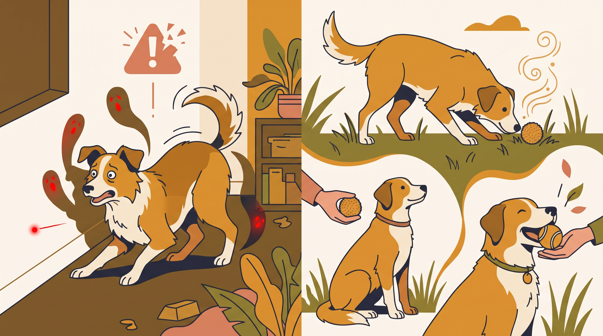

# **06\. Λέιζερ, μπαλάκι και διελκυστίνδα: Πώς κρατάμε το παιχνίδι ισορροπημένο**

**Κατηγορία:** 04 - Εξοπλισμός, Λιχουδιές & Αισθητηριακός Πλούτος  
**Προτεινόμενο URL:** /blog/paixnidia-pou-anevazoun-entasi-laser-mpalaki  
**Χρόνος ανάγνωσης:** 2 λεπτά

**Με μια ματιά (TL;DR)**

> * Αποφεύγουμε το λέιζερ ως παιχνίδι καταδίωξης για σκύλους.
> * Η μπάλα δεν είναι από μόνη της πρόβλημα, αλλά η ένταση και η επανάληψη χρειάζονται όρια.
> * Δίνουμε δυνατότητα σύλληψης παιχνιδιού, παύσεις και κατάλληλη κίνηση.

## **Διέγερση δεν σημαίνει πάντα κακή εμπειρία**

Το παιχνίδι μπορεί να είναι ζωηρό και ευχάριστο. Προβληματιζόμαστε όταν ο σκύλος δεν μπορεί να σταματήσει, αγνοεί σωματική δυσφορία ή συνεχίζει να ψάχνει φώτα και σκιές μετά το τέλος.

Το λέιζερ δεν προσφέρει πραγματικό αντικείμενο σύλληψης και μπορεί να ενθαρρύνει επίμονη αναζήτηση φωτεινών ερεθισμάτων. Δεν χρειάζεται να περιμένουμε τέτοια δυσκολία για να επιλέξουμε ασφαλέστερο παιχνίδι.

## **Πώς παίζουμε με ισορροπία**

1. **Επιλέξτε κατάλληλη επιφάνεια:** Όχι γλιστερό πάτωμα, καυτή άσφαλτος ή χώρος με εμπόδια.
2. **Περιορίστε απότομα άλματα και στροφές:** Ιδιαίτερα σε αναπτυσσόμενο σκύλο ή μυοσκελετικό πρόβλημα, με κτηνιατρική καθοδήγηση.
3. **Παίξτε διελκυστίνδα ήπια:** Κατάλληλο μακρύ παιχνίδι, χωρίς τίναγμα αυχένα ή σήκωμα του σκύλου από το έδαφος.
4. **Κάντε μικρές παύσεις:** Εθελοντική ανταλλαγή, νερό και ήρεμη μετάβαση σε άλλη δραστηριότητα.

## **Πότε σταματάμε**

Χωλότητα, δυσκολία αναπνοής, εξάντληση ή αδυναμία αποδέσμευσης απαιτούν παύση. Αν επιμένει να κυνηγά σκιές ή αντανακλάσεις, ζητήστε κτηνιατρική και συμπεριφορική αξιολόγηση, όχι περισσότερη έκθεση.

Δεν αφαιρούμε κάθε χαρά από το παιχνίδι. Προσαρμόζουμε διάρκεια και ένταση ώστε ο σκύλος να μπορεί να συμμετέχει και να ξεκουράζεται άνετα.

**Διαβάστε επίσης:** [Παιχνίδι ή σύγκρουση μεταξύ σκύλων](/blog/paixnidi-skylon-i-kavgas-pos-ksexorizoume).
