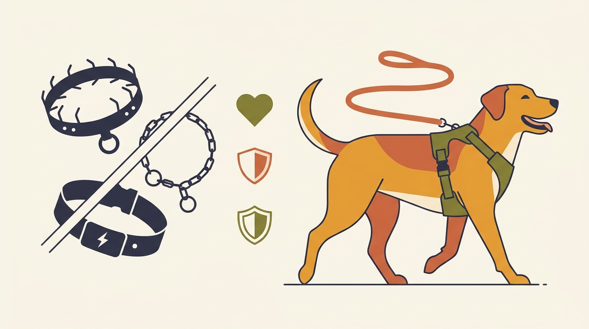

# **04\. Γιατί αποφεύγουμε πνίχτες, αγκαθωτά και ηλεκτρικά κολάρα στην εκπαίδευση**

**Κατηγορία:** 05 - Επιστήμη, Θετική Εκπαίδευση & Κατάρριψη Μύθων  
**Προτεινόμενο URL:** /blog/giati-apofevgoume-pnixtes-ilektrika-kolara  
**Χρόνος ανάγνωσης:** 2 λεπτά

**Με μια ματιά (TL;DR)**

> * Μια συμπεριφορά που σταμάτησε δεν σημαίνει ότι λύθηκε η αιτία της.
> * Πόνος και εκφοβισμός μπορούν να επιβαρύνουν φόβο και εμπιστοσύνη.
> * Επιλέγουμε διαχείριση, εκπαίδευση και κατάλληλη υποστήριξη.

## **Η σιωπή δεν είναι πάντα ηρεμία**

Ένας σκύλος μπορεί να σταματήσει να γαβγίζει για να αποφύγει μια δυσάρεστη συνέπεια. Αν εξακολουθεί να φοβάται τον άλλο σκύλο, η απουσία ήχου δεν αποδεικνύει ασφάλεια. Παρατηρούμε επίσης ένταση, αποφυγή και δυνατότητα ανάπαυσης.

Πνίχτες, αγκαθωτά κολάρα και ηλεκτρικά ερεθίσματα μπορούν να λειτουργούν μέσω πόνου ή δυσφορίας. Δεν προκαλεί κάθε χρήση την ίδια βλάβη, αλλά το ρίσκο δεν είναι αναγκαίο για να διδάξουμε χρήσιμες δεξιότητες.

## **Αν χρησιμοποιείτε ήδη τέτοιο εργαλείο**

1. **Μην ντραπείτε να αλλάξετε:** Πολλοί κηδεμόνες ακολούθησαν συμβουλή που παρουσιάστηκε ως μονόδρομος.
2. **Οργανώστε ασφαλή μετάβαση:** Σε δυνατό ή αντιδραστικό σκύλο, ζητήστε σωστή εφαρμογή εξοπλισμού και σχέδιο ελέγχου πριν την επόμενη δύσκολη έξοδο.
3. **Μειώστε την έκθεση:** Επιλέξτε ήσυχη διαδρομή και περισσότερο χώρο. Η αλλαγή κολάρου δεν διδάσκει από μόνη της χαλαρό λουρί.
4. **Διδάξτε εναλλακτικές:** Εξασκήστε αναστροφή, αυθόρμητο κοίταγμα και μετακίνηση σε ασφαλές σημείο, αρχικά χωρίς έντονα ερεθίσματα.

## **Πότε χρειαζόμαστε ομάδα**

Σε έντονο φόβο ή ιστορικό δαγκώματος συνεργάζονται κτηνίατρος και κατάλληλος επαγγελματίας συμπεριφοράς. Φαρμακευτική υποστήριξη, όταν κρίνεται απαραίτητη από κτηνίατρο, δεν είναι αποτυχία.

Η AVSAB συνιστά εκπαίδευση με επιβράβευση για όλες τις περιπτώσεις, μαζί με διαχείριση και αντιμετώπιση των αιτιών.

**Πηγή:** [AVSAB, Humane Dog Training](https://avsab.org/wp-content/uploads/2021/08/AVSAB-Humane-Dog-Training-Position-Statement-2021.pdf).

**Διαβάστε επίσης:** [Αντιδραστικότητα στο λουρί](/blog/antidrastikos-skylos-sto-louri).
