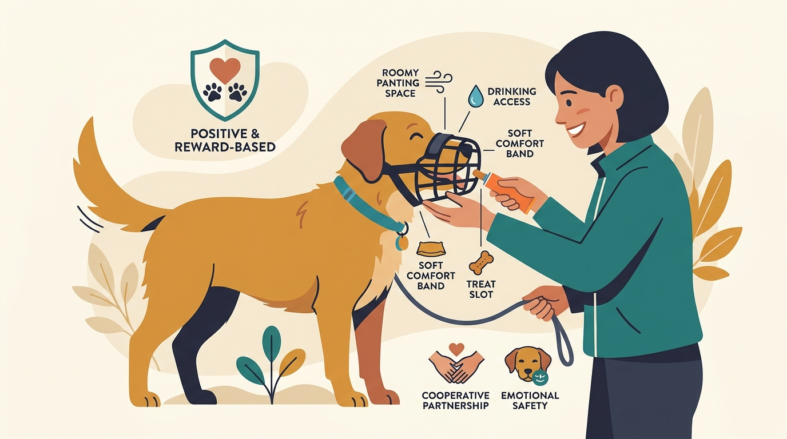

# **03\. Εκπαίδευση φίμωτρου με θετικό τρόπο: Ένα χρήσιμο εργαλείο ασφάλειας**

**Κατηγορία:** 06 - Συνεργατική Φροντίδα, Κτηνίατρος & Grooming  
**Προτεινόμενο URL:** /blog/ekpaidefsi-fimotrou-thetiki-methodos  
**Χρόνος ανάγνωσης:** 2 λεπτά

**Με μια ματιά (TL;DR)**

> * Το φίμωτρο είναι μέτρο μείωσης κινδύνου, όχι τιμωρία.
> * Χρειάζεται σωστή εφαρμογή και χώρο για πλήρες λαχάνιασμα.
> * Δεν αντικαθιστά την επίβλεψη, την απόσταση ή τη θεραπεία.

## **Πρώτα η σωστή επιλογή**

Για μεγαλύτερη διάρκεια συνήθως επιλέγεται κατάλληλο φίμωτρο τύπου καλαθιού, που επιτρέπει άνετη αναπνοή και, ανάλογα με το σχέδιο, νερό και επιβράβευση. Τα στενά υφασμάτινα μοντέλα που κρατούν το στόμα κλειστό δεν είναι κατάλληλα για βόλτα ή άσκηση.

Δεν εμποδίζουν όλα τα φίμωτρα την κατάποση σκουπιδιών ή κάθε πιθανό δάγκωμα. Η χρήση για τέτοιο κίνδυνο χρειάζεται ειδική επιλογή με επαγγελματία. Σκύλος με αναπνευστικό πρόβλημα χρειάζεται και κτηνιατρική καθοδήγηση.

## **Η μουσούδα μπαίνει εθελοντικά**

1. **Παρουσιάστε το φίμωτρο:** Αφήστε τον σκύλο να το παρατηρήσει και επιβραβεύστε χωρίς να το πλησιάζετε στο πρόσωπό του.
2. **Ενθαρρύνετε σύντομη είσοδο:** Κρατήστε το σταθερό και προσφέρετε τροφή μέσα ή από μπροστά. Αφήστε τον να βγάλει αμέσως τη μουσούδα.
3. **Χτίστε διάρκεια πριν το κούμπωμα:** Επιβραβεύστε μικρές στιγμές παραμονής. Η κίνηση του ιμάντα εξασκείται ξεχωριστά.
4. **Προσθέστε κούμπωμα και κίνηση σταδιακά:** Πρώτα ελάχιστος χρόνος στο σπίτι, έπειτα λίγα βήματα. Αφαιρέστε το πριν αρχίσει έντονη προσπάθεια να το βγάλει.

## **Τι δεν κάνουμε**

Δεν το φοράμε για πρώτη φορά μέσα σε κρίση ως «μάθημα». Δεν αφήνουμε τον σκύλο μόνο ή δεμένο με φίμωτρο και δεν τον εκθέτουμε πιο κοντά σε ερεθίσματα επειδή το φορά.

Ελέγχετε για τριβές, δυσκολία αναπνοής και υπερθέρμανση. Οι κανόνες μεταφοράς διαφέρουν: το φίμωτρο δεν αντικαθιστά υποχρεωτικό κλωβό στα ΜΜΜ.

**Διαβάστε επίσης:** [Σκύλος στα ΜΜΜ της Αθήνας](/blog/skylos-sto-metro-mmm-athina).
