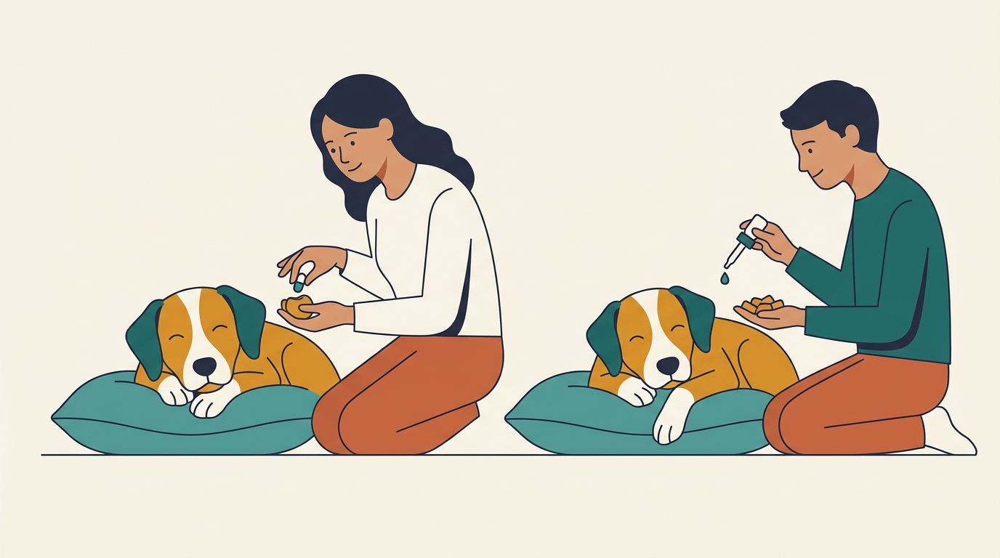

# **05\. Πώς να βάζετε σταγόνες στα αυτιά/μάτια και να δίνετε χάπι στον σκύλο σας χωρίς πάλη**

**Κατηγορία:** 06 - Συνεργατική Φροντίδα, Κτηνίατρος & Grooming  
**Προτεινόμενο URL:** /blog/pos-na-doso-xapi-stagones-se-skylo  
**Χρόνος ανάγνωσης:** 2 λεπτά

**Με μια ματιά (TL;DR)**

> * Ακολουθούμε ακριβώς τη συνταγή και τις οδηγίες χορήγησης.
> * Δεν σπάμε, αλέθουμε ή αναμειγνύουμε φάρμακα χωρίς έγκριση.
> * Αν δεν μπορεί να δοθεί η αγωγή, επικοινωνούμε έγκαιρα με τον κτηνίατρο.

## **Εκπαίδευση και θεραπεία έχουν διαφορετικό ρυθμό**

Το ακούμπισμα του πηγουνιού σε χέρι ή πετσέτα μπορεί να βοηθήσει στην εξάσκηση ήπιων χειρισμών. Χτίζεται όμως πριν υπάρξει ανάγκη, όχι υποχρεωτικά μέσα σε επώδυνο επεισόδιο. Μάτι που πονά ή αυτί με φλεγμονή χρειάζεται κατάλληλη ιατρική αντιμετώπιση.

Μην χρησιμοποιείτε παλιά φάρμακα ή προϊόντα άλλου ζώου. Παρόμοια συμπτώματα μπορεί να απαιτούν διαφορετική θεραπεία.

## **Προετοιμασία βήμα-βήμα**

1. **Επιβεβαιώστε τις οδηγίες:** Ρωτήστε αν το χάπι επιτρέπεται με τροφή και τι γίνεται αν χαθεί ή αποβληθεί μια δόση.
2. **Δοκιμάστε ασφαλή μορφή:** Αν εγκριθεί, κρύψτε το σε μικρή ποσότητα κατάλληλης τροφής και ελέγξτε ότι καταπόθηκε. Μην το βάλετε σε ολόκληρο γεύμα που μπορεί να μείνει μισό.
3. **Χτίστε ήρεμη θέση χωριστά:** Επιβραβεύστε σύντομο ακούμπισμα πηγουνιού. Αν σηκώσει το κεφάλι, σταματήστε την εκπαιδευτική άσκηση.
4. **Ζητήστε επίδειξη για σταγόνες:** Ακολουθήστε τις οδηγίες της ομάδας χωρίς να ακουμπά το στόμιο σε μάτι ή αυτί και χωρίς αυτοσχέδιους βαθιούς καθαρισμούς.

## **Αν δυσκολευτείτε**

Μην διπλασιάζετε δόση επειδή δεν είστε βέβαιοι ότι δόθηκε. Καλέστε τον κτηνίατρο για ασφαλή επόμενα βήματα ή εναλλακτική μορφή.

Σε αντίσταση, γρύλισμα ή πόνο δεν κάνουμε επαναλαμβανόμενη πάλη. Αν υπάρχει επείγον οφθαλμολογικό σύμπτωμα, σοβαρή αντίδραση ή αδυναμία χορήγησης απαραίτητης θεραπείας, ζητήστε άμεσα βοήθεια.

**Διαβάστε επίσης:** [Συνεργατική φροντίδα στον κτηνίατρο](/blog/skylos-fovatai-ton-ktiniatro).
