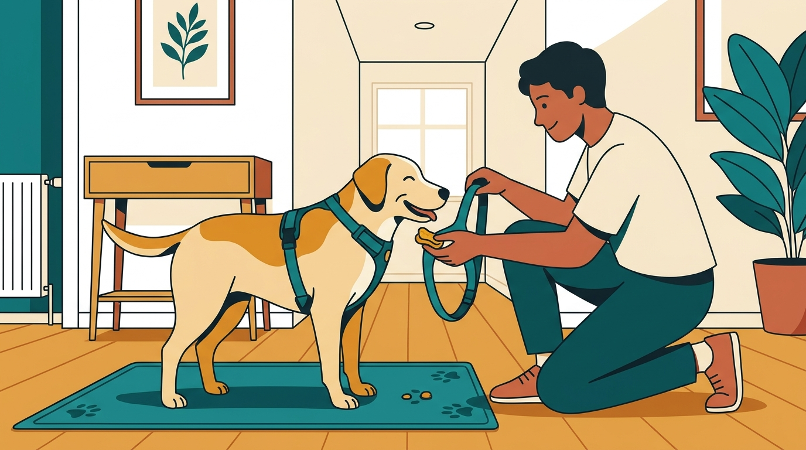

# **06\. Ο σκύλος δεν με αφήνει να του βάλω το σαμαράκι ή να του σκουπίσω τα πόδια μετά τη βόλτα**

**Κατηγορία:** 06 - Συνεργατική Φροντίδα, Κτηνίατρος & Grooming  
**Προτεινόμενο URL:** /blog/skylos-antidra-sto-samaraki-podia  
**Χρόνος ανάγνωσης:** 2 λεπτά

**Με μια ματιά (TL;DR)**

> * Η απομάκρυνση μπορεί να σημαίνει δυσφορία, όχι απροθυμία για βόλτα.
> * Ελέγχουμε εφαρμογή, τριβές και πιθανό πόνο.
> * Διδάσκουμε τη ρουτίνα σε ήρεμη στιγμή, μακριά από την πίεση της εξόδου.

## **Η είσοδος είναι στενό σημείο**

Όταν σκύβουμε από πάνω του, πιάνουμε πατούσες και περνάμε ιμάντες στο κεφάλι, ο σκύλος μπορεί να νιώθει παγιδευμένος. Αν το σαμαράκι τρίβει ή τα πόδια πονάνε, η προσμονή χειρισμού γίνεται ακόμη δυσκολότερη.

Παρατηρήστε αν αντιδρά στο ίδιο το αντικείμενο, στην κίνηση των χεριών ή μόνο σε συγκεκριμένο σημείο του σώματος. Ξαφνική αλλαγή χρειάζεται κτηνιατρική εκτίμηση.

## **Χτίζουμε προβλέψιμη ρουτίνα**

1. **Μετακινήστε την εξάσκηση:** Καθίστε πλάγια σε ευρύχωρο δωμάτιο. Αφήστε ελεύθερη έξοδο.
2. **Δείξτε και απομακρύνετε:** Παρουσιάστε το σαμαράκι ή την πετσέτα, επιβραβεύστε ήρεμη παρατήρηση και κάντε παύση.
3. **Χωρίστε τις κινήσεις:** Εθελοντική προσέγγιση, σύντομη επαφή, ένα κούμπωμα. Μην κρατάτε το κεφάλι μέσα με τροφή ενώ κλείνετε βιαστικά τα υπόλοιπα.
4. **Για τα πόδια, ξεκινήστε απλά:** Βάλτε απορροφητικό αντιολισθητικό χαλάκι στην είσοδο. Διδάξτε εθελοντική παραμονή και κατόπιν ελάχιστο άγγιγμα με μαλακή πετσέτα.

## **Πρακτικές αλλαγές**

Μοντέλο που ανοίγει στον λαιμό μπορεί να βοηθήσει σκύλο που δυσκολεύεται με πέρασμα από το κεφάλι. Η σωστή εφαρμογή παραμένει σημαντικότερη από την εμπορική ονομασία.

Μην τραβάτε τις πατούσες ψηλά ή πλάγια. Αν υπάρχουν πληγές, κοκκινίλα, ξένο σώμα ή έντονη αντίδραση, ζητήστε κτηνιατρική βοήθεια αντί να επιμείνετε στο σκούπισμα.

**Διαβάστε επίσης:** [Εφαρμογή σαμαριού τύπου Υ](/blog/odigos-epilogis-samaraki-typou-y).
