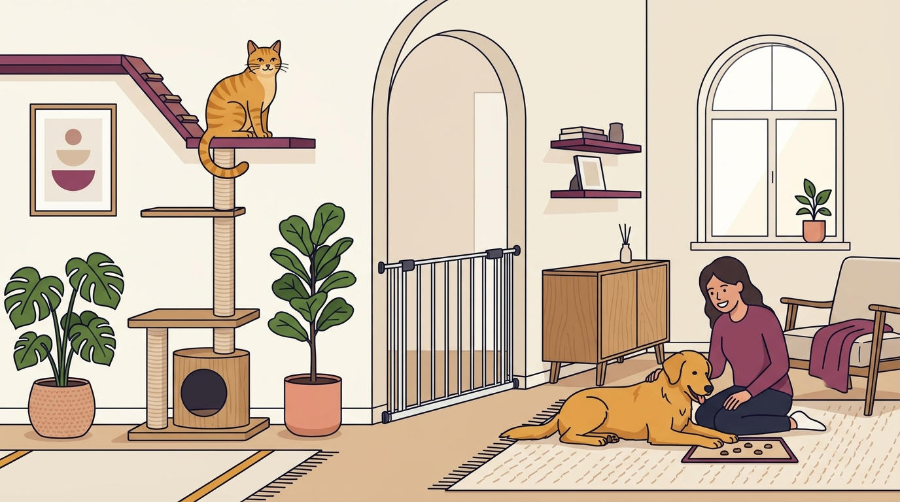

# **02\. Σκύλος και Γάτα στο ίδιο διαμέρισμα: Οδηγός ασφαλούς γνωριμίας βήμα-βήμα**

**Κατηγορία:** 07 - Οικογένεια, Μωρά, Παιδιά & Πολλά Κατοικίδια  
**Προτεινόμενο URL:** /blog/symviosi-skylou-gatas-sto-spiti  
**Χρόνος ανάγνωσης:** 2 λεπτά

**Με μια ματιά (TL;DR)**

> * Η γάτα χρειάζεται δικό της ασφαλή χώρο και διαδρομές διαφυγής.
> * Προχωράμε μόνο όταν και τα δύο ζώα είναι άνετα.
> * Η απουσία γαβγίσματος δεν αποκλείει κίνδυνο καταδίωξης.

## **Δεν αρκεί να τους πούμε «γίνετε φίλοι»**

Η γνωριμία μπορεί να διαρκέσει πολύ και δεν καταλήγει πάντα σε ασφαλή συμβίωση. Επίμονο κοίταγμα, χαμηλό πλησίασμα και ξαφνική καταδίωξη από τον σκύλο είναι σοβαρές ενδείξεις. Η γάτα δεν πρέπει να χρησιμοποιείται ως δοκιμή του αυτοελέγχου του.

Πριν αρχίσετε, οργανώστε χωριστά φαγητό, νερό, ύπνο και αμμολεκάνη. Ψηλά σημεία βοηθούν, αλλά δεν αντικαθιστούν μια ασφαλή κλειστή πόρτα.

## **Σταδιακή προσέγγιση**

1. **Ξεκινήστε χωρίς οπτική επαφή:** Αφήστε κάθε ζώο να προσαρμοστεί στον χώρο του. Ανταλλάξτε προαιρετικά υφάσματα με οσμές, χωρίς να τα πιέζετε κοντά.
2. **Συνδέστε την παρουσία με άνεση:** Ήρεμη δραστηριότητα σε αρκετή απόσταση από την κλειστή πόρτα. Αν δεν τρώνε ή παραμένουν σε επιφυλακή, αυξήστε απόσταση.
3. **Προσθέστε προστατευμένη θέαση:** Μόνο με ασφαλές εμπόδιο που δεν μπορούν να υπερπηδήσουν ή παρακάμψουν και με ενήλικη επίβλεψη.
4. **Κρατήστε τις συναντήσεις σύντομες:** Επιβραβεύστε αποδέσμευση της προσοχής. Σταματήστε πριν υπάρξει κυνήγι, όχι αφού ξεκινήσει.

## **Κρίσιμα όρια**

Μην κρατάτε τη γάτα αγκαλιά μπροστά στον σκύλο και μην την κλείνετε σε κλουβί για να την πλησιάσει. Μην αφήνετε τα ζώα μόνα μαζί μέχρι να υπάρχει τεκμηριωμένη ασφάλεια· σε ορισμένες περιπτώσεις χρειάζεται μόνιμος χωρισμός.

Ιστορικό τραυματισμού γάτας ή έντονη προσήλωση απαιτεί επαγγελματική αξιολόγηση πριν από άμεση επαφή.

**Διαβάστε επίσης:** [Διαχείριση καταδίωξης γατών](/blog/skylos-kynigaei-gates-sti-volta).
