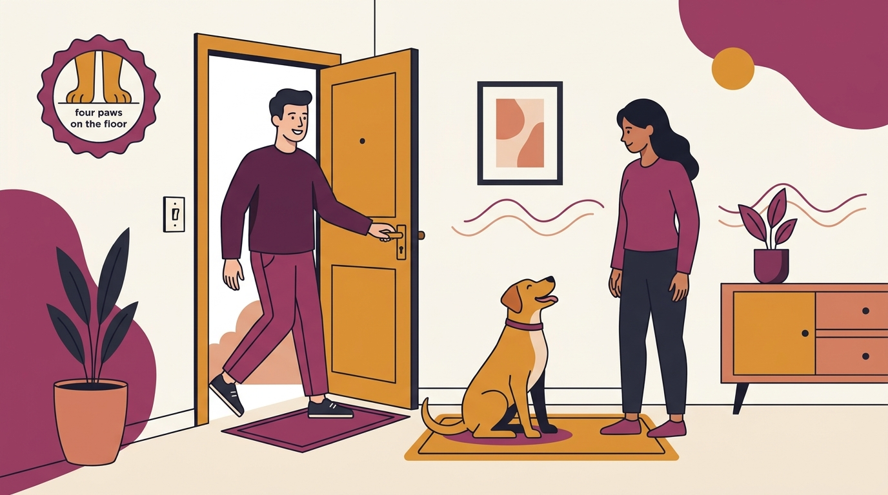

# **05\. Ο σκύλος μου πηδάει πάνω στους καλεσμένους όταν μπαίνουν στο σπίτι: Πώς του μαθαίνουμε ήρεμο χαιρετισμό**

**Κατηγορία:** 07 - Οικογένεια, Μωρά, Παιδιά & Πολλά Κατοικίδια  
**Προτεινόμενο URL:** /blog/skylos-pidaei-stous-kalesmenous  
**Χρόνος ανάγνωσης:** 2 λεπτά

**Με μια ματιά (TL;DR)**

> * Ο χαιρετισμός οργανώνεται πριν χτυπήσει το κουδούνι.
> * Επιβραβεύουμε τέσσερις πατούσες στο πάτωμα.
> * Δεν υποχρεώνουμε φοβισμένο σκύλο να γνωρίσει επισκέπτες.

## **Γιατί η πόρτα ανεβάζει την ένταση**

Ο ήχος, η κίνηση και η πιθανή επαφή γίνονται ένα μεγάλο γεγονός. Αν κάθε άλμα φέρνει χάδια ή έντονη ομιλία, μπορεί να επαναλαμβάνεται. Δεν είναι όμως κάθε πήδημα χαρούμενος ενθουσιασμός: παρατηρήστε και πιθανή δυσφορία.

Η εξάσκηση λειτουργεί καλύτερα με συνεργάσιμο ενήλικα επισκέπτη και εύκολες πρόβες. Μια πραγματική γιορτή δεν είναι κατάλληλη πρώτη δοκιμή.

## **Ένα πλάνο για την είσοδο**

1. **Χρησιμοποιήστε διαχωρισμό:** Ο σκύλος περιμένει σε άνετο χώρο πίσω από εμπόδιο όσο μπαίνει ο επισκέπτης.
2. **Συμφωνήστε ήρεμο χαιρετισμό:** Ο επισκέπτης δεν σκύβει, δεν φωνάζει και δεν απλώνει χέρια πάνω από το κεφάλι.
3. **Επιβραβεύστε πριν το άλμα:** Δώστε μικρή λιχουδιά χαμηλά όταν οι πατούσες είναι στο πάτωμα. Η καθιστή θέση είναι προαιρετική, όχι απαραίτητη.
4. **Κάντε παύση αν ανεβαίνει η ένταση:** Αυξήστε απόσταση και επιστρέψτε σε ευκολότερη πρόβα. Μην συνεχίζετε μέχρι να κουραστεί.

## **Διαφορετική λύση για διαφορετικό συναίσθημα**

Σε άλματα από ενθουσιασμό, ο επισκέπτης μπορεί να περιμένει ήρεμα χωρίς επαφή μέχρι να πατήσει κάτω. Αν υπάρχει φόβος, πάγωμα ή γρύλισμα, δεν ζητάμε από τον επισκέπτη να δίνει τροφή από το χέρι για να τον τραβήξει κοντά.

Δεν χρησιμοποιούμε γόνατο στο στήθος, σπρώξιμο ή τινάγματα λουριού. Παιδιά και ευάλωτοι επισκέπτες προστατεύονται με φυσικό χωρισμό, όχι με την ελπίδα ότι η άσκηση θα πετύχει.

**Διαβάστε επίσης:** [Γάβγισμα στο κουδούνι](/blog/skylos-gavgizei-sto-koudouni-polykatoikia).
