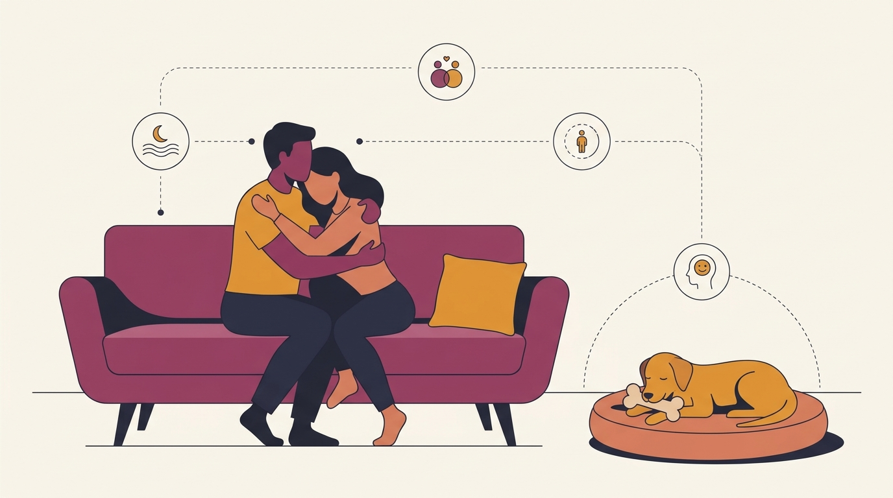

# **06\. Ζήλια στον σκύλο όταν αγκαλιάζω τον/την σύντροφό μου: Είναι όντως ζήλια ή κάτι άλλο;**

**Κατηγορία:** 07 - Οικογένεια, Μωρά, Παιδιά & Πολλά Κατοικίδια  
**Προτεινόμενο URL:** /blog/skylos-zilevei-otan-agkaliazomaste  
**Χρόνος ανάγνωσης:** 2 λεπτά

**Με μια ματιά (TL;DR)**

> * Η παρέμβαση δεν αποδεικνύει ένα συγκεκριμένο συναίσθημα.
> * Παρατηρούμε διέγερση, αναζήτηση προσοχής και πιθανή δυσφορία.
> * Αν υπάρχει απειλή ή φύλαξη ανθρώπου, προηγείται ασφαλής διαχείριση.

## **Δεν γνωρίζουμε το κίνητρο μόνο από την εικόνα**

Ένας σκύλος που μπαίνει ανάμεσα σε δύο ανθρώπους μπορεί να ζητά συμμετοχή, να έχει μάθει ότι έτσι κερδίζει προσοχή ή να δυσκολεύεται με την έντονη κίνηση. Το «ζηλεύει» είναι μια πιθανή καθημερινή περιγραφή, όχι διάγνωση.

Σημειώστε τι συμβαίνει πριν και μετά: εμφανίζεται μόνο στον καναπέ, με συγκεκριμένο άτομο ή σε κάθε έντονη επαφή; Υπάρχει χαλαρό σώμα ή ακαμψία και γρύλισμα;

## **Χτίζουμε μια ήρεμη εναλλακτική**

1. **Διδάξτε ξεκούραση σε χαλάκι:** Ξεκινήστε όταν δεν αγκαλιάζεται κανείς και επιβραβεύστε εθελοντική παραμονή.
2. **Προσθέστε ελάχιστη κίνηση:** Δύο ενήλικες πλησιάζουν λίγο μεταξύ τους, ενώ ο σκύλος βρίσκεται άνετα σε απόσταση.
3. **Επιβραβεύστε την άνεση:** Η σύντομη επαφή των ανθρώπων ακολουθείται από ήρεμη ανταμοιβή στο χαλάκι.
4. **Προχωρήστε αργά:** Αν πετάγεται, μειώστε διάρκεια και ένταση. Δεν κάνουμε προκλητικές «δοκιμές» για να μάθει.

## **Πότε σταματά η άσκηση στο σπίτι**

Αν γρυλίζει, μπλοκάρει άνθρωπο ή απειλεί δάγκωμα, μην τον σπρώχνετε από τον καναπέ και μην τραβάτε το κολάρο. Χρησιμοποιήστε χωριστούς χώρους και ζητήστε κτηνιατρική και συμπεριφορική αξιολόγηση.

Κρατήστε την καθημερινή επαφή μαζί του προβλέψιμη, χωρίς να χρειάζεται να παρεμβαίνει για να ακουστεί. Το ζητούμενο δεν είναι να «δεχτεί τη θέση του», αλλά να νιώθει άνετα με τις οικογενειακές κινήσεις.

**Διαβάστε επίσης:** [Φύλαξη πόρων και χώρου](/blog/skylos-grylizei-sto-fagito-kanape).
