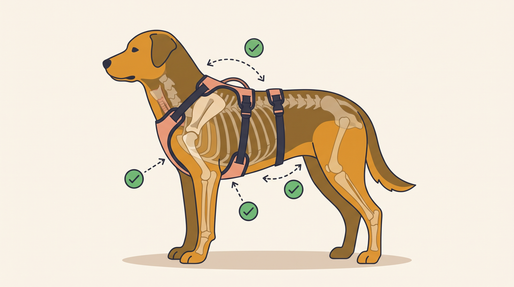

# **01\. Οδηγός Επιλογής & Εφαρμογής για Σαμαράκι Τύπου Υ: Πώς να ελέγξετε αν ενοχλεί τους ώμους του σκύλου**

**Κατηγορία:** 16 - Εξοπλισμός, Λιχουδιές & Αισθητηριακός Πλούτος  
**Προτεινόμενο URL:** /blog/odigos-epilogis-samaraki-typou-y  
**Χρόνος ανάγνωσης:** 2 λεπτά

**Με μια ματιά (TL;DR)**

> * Το σχήμα Υ δεν εγγυάται σωστή εφαρμογή σε κάθε σκύλο.
> * Ελέγχουμε κίνηση, τριβές και πιθανότητα διαφυγής.
> * Η δοκιμή γίνεται ήρεμα, χωρίς να τραβάμε τον σκύλο για έλεγχο.

## **Η εφαρμογή είναι δυναμική**

Ένα σαμαράκι μπορεί να φαίνεται σωστό όταν στέκεται και να περιστρέφεται όταν περπατά. Το μήκος των ιμάντων, η ανατομία και το σημείο σύνδεσης επηρεάζουν την κίνηση.

Μετρήστε σύμφωνα με τον κατασκευαστή και, όπου γίνεται, δοκιμάστε πριν αγοράσετε. Η ένδειξη βάρους δεν αντικαθιστά τις διαστάσεις.

## **Τέσσερις έλεγχοι**

1. **Μπροστινό μέρος:** Οι ιμάντες δεν πιέζουν την τραχεία και δεν εμποδίζουν εμφανώς την κίνηση.
2. **Θώρακας και μασχάλες:** Δεν υπάρχει τρίψιμο, τσίμπημα δέρματος ή συνεχής μετατόπιση.
3. **Σταθερότητα:** Το σαμαράκι δεν είναι τόσο χαλαρό ώστε να βγει εύκολα, ούτε τόσο σφιχτό ώστε να περιορίζει αναπνοή και κίνηση.
4. **Βάδισμα:** Παρατηρήστε λίγα ήρεμα βήματα. Αν αλλάζει στάση ή αποφεύγει να κινηθεί, επανελέγξτε εφαρμογή και άνεση.

## **Ειδικές ανάγκες**

Για φοβισμένο σκύλο που κάνει όπισθεν χρειάζεται ιδιαίτερο πλάνο πρόληψης απόδρασης, πιθανώς ειδικό μοντέλο και δεύτερη σύνδεση. Κανένα προϊόν δεν είναι απολύτως αδύνατο να βγει.

Ο μπροστινός κρίκος δεν αποτελεί αυτόματη θεραπεία τραβήγματος. Αποφύγετε συνεχή πλάγια έλξη και ζητήστε καθοδήγηση.

Επανελέγχετε εφαρμογή σε κουτάβια, αλλαγές βάρους και μετά από φθορά. Αν εμφανίζονται πόνος, βήχας ή δερματικές βλάβες, συμβουλευτείτε κτηνίατρο. Η αποδοχή του εξοπλισμού χρειάζεται επίσης ήρεμη εξοικείωση.

**Διαβάστε επίσης:** [Αντίδραση στο σαμαράκι](/blog/skylos-antidra-sto-samaraki-podia).
